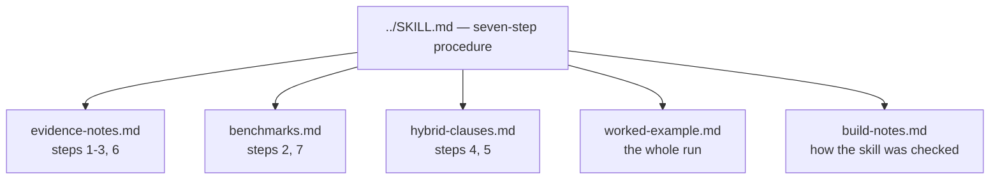

# References index — Inbound Sponsorship

These references support **Inbound Sponsorship**, version **0.1.2**. The main [`../SKILL.md`](../SKILL.md) holds the guardrails, the seven-step procedure, and the output contract. These files carry the depth: the evidence behind the rules, the benchmark tables, the clause language, one worked example, and the build record.

Read the main skill first. Open a reference when a step needs depth. Do not load every file by default.

- `evidence-notes.md` — the studies and doctrine behind the rules: the first-offer meta-analysis, the information condition, precision, MESO packages, the budget-question doctrine, response speed, and the myth the skill refuses to teach. Every claim carries its label: studied, borrowed, or practitioner.

- `benchmarks.md` — pricing tables for newsletters, podcasts, video, and sponsored posts, each figure with its basis (opens, subscribers, downloads, views) and its source, plus the rule that bases never mix inside one comparison.

- `hybrid-clauses.md` — fill-in clause language: the floor, the guarantee boundary, the test box, tracking, term and remedy, renewal with auto-charge, disclosure, and the pure-CPA counter.

- `worked-example.md` — one inbound inquiry walked through triage, lane choice, and a draft reply with a bracketed-range ask, written as shapes only, with a card-lane contrast at the end.

- `build-notes.md` — the record of the four-skill pass run over this package before release: what each pass checked and what it changed.
