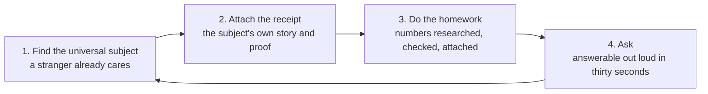

#  interview-yourself (open skill)

**An AI interviewer that turns your lived experience into content by asking you questions worth answering.** Each question hangs on a subject a stranger already cares about, carries the receipt from your own week, and arrives with its numbers researched and attached, so you answer out loud in about thirty seconds and your answers become posts.

##  What this is

Most people with something to say do not lack material. They lack a good question at a moment they can answer it. Left to itself, an interviewer mines your workday for topics, and the workday is procedure: dashboards, tickets, meetings. Procedure is not content, and questions mined from it come back as homework: report your data, look up your figures, then have an opinion.

This skill splits the question in two. The topic comes from the universal subjects, the things the world already argues about: money, failure, starting over, trust. Your week and work supply only the receipt: the story and the proof that you have earned a take. The interviewer does the homework (the numbers, researched and checked, attached before asking), so all you ever do is riff. The skill's job ends at the question: drafting your answers into posts belongs to the voice and structure skills, where they exist.

##  Who it is for

| Who | Why it fits |
|---|---|
| Founders and operators | Your weeks are full of receipts and empty of writing time. Thirty seconds of talking beats an hour at a blank page. |
| Experts and advisors | Your value is judgment earned over years. Good questions surface it in your own words, on the record. |
| Creators who hate drafting | You think by talking. The interview carries the structure; you just answer. |
| Agents serving any of the above | The gate gives you a mechanical standard: no question ships without its subject, its receipt, and its numbers. |

##  Process at a glance

##  How to use with an agent

| Step | What to give the agent |
|---|---|
| Ask for a set | "Interview me. Use the interview-yourself skill: three questions, each with its universal subject, its receipt, and its numbers attached." |
| Answer out loud | Reply by voice note. Thirty seconds each is the design point; longer is fine, looking things up is a sign the question failed. |
| Send answers onward | "Draft that answer with my voice skill, and build the piece with the structure skill." This skill stops at the question, on purpose. |
| Grade a bad set | "Which rule did that question fail: the stranger test, the receipt rule, the homework, or the riff test?" The patterns file has the pairs to grade against. |

##  Folder map

| Path | What it holds |
|---|---|
| `SKILL.md` | The method: the principle, the output contract, the five rules, the gate, the guardrails, the limits, the verification checklist. |
| `references/worked-example.md` | The run the method was distilled from: the set that failed wholesale, the three questions that replaced it, the rebuild. De-identified shapes only. |
| `references/question-patterns.md` | The five rules as pass-and-fail question pairs, with generic subjects. |
| `assets/icons/` | The icon set (Hugeicons, free version) used across the playbooks. |

##  Sources and credits

The method is the author's own, distilled from a production self-interview run: the failure (a set of process-mined, report-the-data questions, rejected wholesale) is recorded alongside the rules it produced, in `references/worked-example.md`. The underlying craft is the oldest one in interviewing: ask about something the listener already cares about, of the one person whose life proves they have earned the answer. No source text is reproduced.

##  Contributing

Improvements are welcome. Field reports are the most valuable contribution: a set built under the skill, which questions were answered and which died, and what the answers became. A proposed rule needs a dead question behind it; that is how the existing five got in.

##  License

MIT. See the repository LICENSE file.

##  Version

0.1.0 — See `CHANGELOG.md`.

## Get the skill

Your experience is the material. The right question is the whole bottleneck.

Interview Yourself is free, and it stays free. Get it from its page on my site, and leave an email there to get every update the day it drops: [ianbalina.com/skills/interview-yourself](https://ianbalina.com/skills/interview-yourself/)
