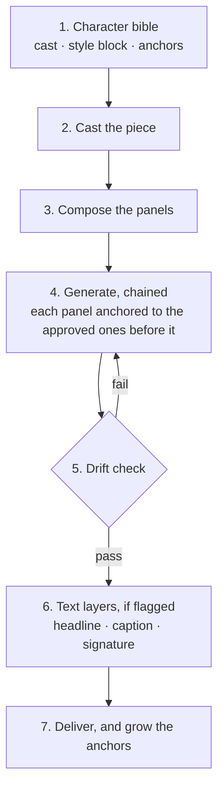

#  mascot-system (open skill)

**Any model can draw your character once. The second drawing is where characters go to die.** This skill keeps a recurring character recognisably the same across a strip, a carousel, a deck, or a character-led video: a character bible holds the cast, each image is generated against the approved images before it, and a drift check fails anything that wanders — the eyes first of all.

##  What this is

An open skill that produces cartoon images as a system rather than as one-off generations.

Most character work is done from a description typed fresh each time. The result is drift: the face changes, the eyes change, the proportions wander, and the audience stops believing it is the same character. This skill works the other way. The character lives in a bible — one entry per cast member, with a reference set of anchor images. Generation is chained: within a piece, every approved image joins the reference set for the next, so continuity compounds instead of resetting. And every image passes a drift check before it ships.

Three things make this version different from a prompt template:

1.  **A bible, not a description** — species, role, proportions, palette, and the eyes as their own field, plus the series' cast rule and locked style block, written once and enforced on every panel.

2.  **Chained generation** — a piece is drawn in sequence, each panel anchored to the bible plus the approved panels before it, so the same setting, the same props, and the same character survive every cut. Change an early panel, and the later ones are re-checked against it.

3.  **Images first, text behind flags** — the skill delivers clean images. A headline, a caption, and the signature block are separate text layers, each behind its own flag — `headline`, `caption`, `signature` — and all three default to off.

##  Who it is for

| Audience | Use |
| --- | --- |
| **Creators with a mascot or cast** | Run a strip, a carousel series, or a character-led channel without the character quietly becoming someone else |
| **Founders / operators** | Keep a brand character identical across decks, launches, and posts, where recognition is the asset |
| **AI agents** | Load `SKILL.md`, open a series' bible, and produce panels that pass a written drift check — with the check result reported per panel |
| **Maintainers** | Refresh `references/` when a series teaches a new drift lesson; bump `version` in `SKILL.md` |

##  Process at a glance

##  How to use with an agent

1. **Load** [`SKILL.md`](./SKILL.md) as the system skill (see your agent's skill docs).
2. **Build the bible**: fill a character bible from the template — series rules, one entry per character, a reference anchor for each. If the piece carries a story, run the storytelling skill first and bring its scene cards.
3. **Set the flags** for the job: `headline`, `caption`, `signature`, each on or off. Leave them off for clean images.
4. **Pull references when needed** (do not paste entire files into context):

| Phase | Read |
| --- | --- |
| Setup — the character bible |  [`references/character-bible-template.md`](./references/character-bible-template.md) |
| Composition — the picture only |  [`references/panel-grammar.md`](./references/panel-grammar.md) |
| Assembly — the flagged text layers |  [`references/text-layers.md`](./references/text-layers.md) |
| Every panel — the drift check |  [`references/drift-check.md`](./references/drift-check.md) |
| Any phase — what good looks like, end to end |  [`references/worked-example.md`](./references/worked-example.md) |

5. **Hold the guardrails** in `SKILL.md` — above all: no character without a bible entry, and a drifted panel is regenerated, never repaired.

##  Folder map

| Path | One line |
| --- | --- |
| [`SKILL.md`](./SKILL.md) | Main skill: when to use / not use, guardrails, the one idea, the text-layer flags, the seven-step core procedure, sibling calls, output contract, limits, verification checklist |
| [`CHANGELOG.md`](./CHANGELOG.md) | Version history |
| [`references/README.md`](./references/README.md) | Index of all reference files |
|  [`references/character-bible-template.md`](./references/character-bible-template.md) | The blank bible: series rules, per-character entries, standing and working reference-set rules |
|  [`references/panel-grammar.md`](./references/panel-grammar.md) | Image composition: the box, the mount, placement and scale, backgrounds, and the move from carousel page to video scene |
|  [`references/text-layers.md`](./references/text-layers.md) | The three flagged text layers and their rules when on |
|  [`references/drift-check.md`](./references/drift-check.md) | The per-panel pass/fail checklist, including the continuity block and the fail procedure |
|  [`references/worked-example.md`](./references/worked-example.md) | A fox explaining game theory: one series through the whole procedure, with one real eye-drift failure |
| [`scripts/verify.sh`](./scripts/verify.sh) | Package check: required files, frontmatter, README sections, references index, icons, and a grep-clean pass — prints PASS/FAIL and exits non-zero on failure |

##  Sources and credits

- The method is **distilled from a working cartoon series**: a newspaper-style strip built to teach business concepts, whose production produced the rules in this package — the bible-first discipline, the chained generation, the mechanical frame mount, and the eyes block of the drift check, which exists because a shipped series' closing panel came back with the wrong eyes and had to be regenerated. The worked example retells that series in public shape; no names or handles are stored in this repo.

- The chaining rule generalises a simple observation from that production: an image model holds a character far better against a picture of the character than against a paragraph about the character, and it holds a setting the same way.

- The skill follows the playbook's own discipline: skills call sibling skills by name — storytelling for the story, funnel-operator for the channel that consumes the panels — and an instance (one series' bible, its anchors, its real signature block) lives in its own folder, outside the package.

##  Contributing

- Open a PR with sharper drift items, new composition rules, or fixes — keep **grep-clean** (no personal or company-specific strings inside the skill folder; series bibles live in their own folders, outside the package).

- When a production teaches a new drift lesson — a trait that wanders, a wording that holds it — add it to the relevant reference, bump **`version`** in `SKILL.md`, and add a **`CHANGELOG.md`** entry.

- New worked examples are welcome, especially ones that name their flags and show a real drift failure and its regeneration.

##  License

MIT — see [`SKILL.md`](./SKILL.md) front matter. Third-party sources remain under their publishers' terms.

##  Version

Current skill version: see `version` in [`SKILL.md`](./SKILL.md) front matter. History: [`CHANGELOG.md`](./CHANGELOG.md).
