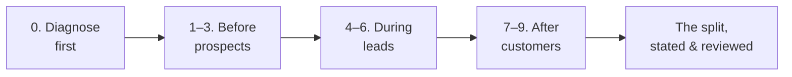

#  1-Page Marketing Plan (open skill)

**The whole marketing system on one page — diagnosed first, then built square by square on evidence about how buyers actually behave.** Nine squares in Allan Dib's order: target market, message, media; capture, nurture, convert; experience, lifetime value, referrals. But no square stands on a guru's say-so where the square has been measured. Reach stands on the Ehrenberg-Bass buying laws. The message stands on distinctive-asset measurement. Follow-up stands on lead-response audits. Lifetime value stands on probability models, estimated and holdout-tested, never asserted. Referrals stand on a tracked cohort with a reward capped by the measured value gap. And over the whole grid, one stated line: how much of the effort builds memory among people not buying yet, and how much harvests the demand that exists — held as a hypothesis, with a review date, because the databank behind the starting ratio is award entries, not a random sample.

##  What this is

An open skill that an AI agent can run, for the planning layer of marketing: the system that individual posts, pages, and campaigns live inside.

Marketing plans usually fail in one of two directions. The tactic pile fills nine boxes with activities and calls the fullness a strategy — no diagnosis underneath, no proportion between building future demand and harvesting present demand, no standards anyone is measured against. The folklore plan is worse: it has numbers, but they are inherited numbers — a lead-response figure from a vendor's brochure, an 80/20 split nobody measured, a loyalty claim whose source data was never produced. This skill takes the disciplined middle. Diagnosis before strategy before tactics. A grid simple enough to fit on one page and be read at a glance. And under every square, the best measured evidence available for that square, labeled with where it was measured — because the user's own numbers are the court of appeal, and the plan names the checks on which they take over.

It answers three questions:

1. What is actually happening — the diagnosis — and what is the one choice, with its sacrifice, that answers it?
2. What does the system do, square by square, from first reach to referral — and what evidence does each square stand on?
3. What is the split between building future demand and harvesting present demand, when will it be reviewed, and which of the user's own numbers will replace the imported ones?

The skill consumes a positioning record when one exists — its message square takes the record's five fields as given — and it plans the system that public moments live in, while the wording of the moments themselves belongs to the comms skill.

##  Who it is for

| Reader | What they get |
| --- | --- |
| Founders and small teams | The whole marketing system on one page, each square a sentence or two, with the choices and their sacrifices stated instead of buried |
| Operators with a tactic pile | A rebuild from the diagnosis up: the same activities, re-founded on evidence, proportioned by a stated split, and given standards that can be audited |
| Businesses with a positioning record | A plan that carries the record to market without re-deciding it — the message square consumes the concept and frame, and the grid does the rest |
| Agents planning for a human approver | An output contract: a 1-page plan with its diagnosis, its split line and review date, its standards, and its evidence notes — readable at a glance |

##  Process at a glance

##  How to use with an agent

| Step | What to give the agent |
| --- | --- |
| Hand over the raw material | What the business sells, to whom, its own numbers where they exist — inquiries, response times, repeat buyers, referred customers |
| Let diagnosis run first | The agent returns a diagnosis and a guiding policy with its sacrifice before any square is filled; push back there, where it is cheap |
| Bring the positioning record if one exists | The record's five fields — Owned concept, Market category, Competitive frame, Best-fit customers, Trade-offs — are consumed by square 2 as given; without one, square 2 runs light and the plan says so |
| Read the page, not a deck | The return is one page: diagnosis, nine squares, the split line with its review date, the standards, and the evidence notes |
| Run the checks | The plan names the audits and measurements on which your own numbers replace the imported evidence — response times, asset scores, the cohort view, the referral gap |

##  Folder map

| Path | What it holds |
| --- | --- |
| `SKILL.md` | The procedure (diagnosis, the three phases, the split), the guardrails, the output contract, and the limits |
| `references/README.md` | Index of the depth material |
| `references/diagnosis-first.md` | Step 0 in full: the strategy kernel, what a diagnosis draws on, and Bothism as referee |
| `references/the-nine-squares.md` | The grid in full: buyer behavior, evidence and its geography, contents, and failure mode for each of the nine squares |
| `references/the-split.md` | The brand-versus-activation layer: the databank and its caveat, the fence, computing your own in-market ratio, and the handover checks |
| `references/worked-example.md` | A composite worked example: a bookkeeping service's complete filled plan, split line included |

##  Sources and credits

The skeleton is Allan Dib's *The 1-Page Marketing Plan* (2016), a practitioner framework used as structure, not evidence. The order of work is Mark Ritson's (diagnosis, strategy, tactics; Bothism as referee), standing on Richard Rumelt's strategy kernel. The evidence is: Byron Sharp with Andrew Ehrenberg and Gerald Goodhardt and the Ehrenberg-Bass Institute (the buying laws — penetration, light buyers, mental and physical availability); John Dawes (the 95-5 rule, as a computable frame); Les Binet and Peter Field (the IPA databank — brand and activation, the split, with the award-entries caveat carried); Jenni Romaniuk (distinctive assets, Fame and Uniqueness); Karen Nelson-Field (attention measurement, with the vendor caveat carried); James Oldroyd with Kristina McElheran and David Elkington (lead response — the audits and the field data); Robert Cialdini (the influence principles, at their measured effect sizes); Peter Fader with Bruce Hardie (lifetime value estimated from recency and frequency); Philipp Schmitt, Bernd Skiera, and Christophe Van den Bulte (referral program economics); Jonah Berger with Katherine Milkman (what people actually pass on — the newspaper dataset; the separate arousal-alone claim, which failed replication, is not used). Popular sources weighed and left out, with the reasons, are named in `SKILL.md` under Limits and boundaries. No source text is reproduced.

##  Contributing

Improvements are welcome. The bar is the same as the method: a proposed change names its evidence — a square whose source has been superseded by better measurement, a rule whose geography was mislabeled, a folklore figure that slipped in wearing a citation — and scored runs (a plan, its checks, and what the user's own numbers eventually showed) are the most valuable contribution there is.

##  License

MIT. See the repository LICENSE file.

##  Version

0.1.0 — first build: diagnosis-first procedure, the nine squares on their evidence, the split layer, and the positioning chain-in. See `CHANGELOG.md`.
