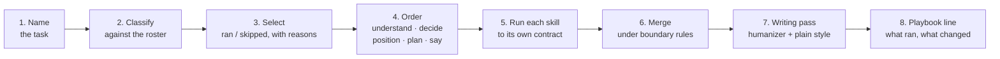

#  playbook (open skill)

**A skill collection only pays when its skills get used — and left to memory, they do not.** This skill is the router for the Made Man Playbooks: hand it a task, and it works out which playbook skills the task needs, runs them for real and in the right order, and hands back one merged answer. The owner stops naming skills. The task pulls them.

##  What this is

An open skill that routes any substantive task through a collection of method skills — the Made Man Playbooks — without the owner having to name the skills one by one.

Without a router, a collection decays into favorites: the two skills everyone remembers get run on everything, the rest gather dust, and tasks that arrive without names get no method at all. This skill works the other way. It classifies the task against each playbook skill's trigger conditions, selects the matches, and runs them in the order the collection is built to run in — understand, decide, position, plan, say — because the later skills consume the earlier skills' outputs. Then it merges everything into one deliverable and closes with the playbook line: which skills ran, and what each one changed.

Three things make this version different from a prompt that says "use your judgment":

1.  **Selection is written down** — every skill in the roster is marked ran or skipped, with a one-line reason, in the run's working notes. A wrong selection can be argued with and fixed. A silent one cannot.

2.  **Running means running** — a selected skill's full procedure executes, to its own output contract, with its own guardrails and gates binding the merged run. Naming a skill without running it is the failure this skill exists to prevent, and the closing playbook line is the receipt that it did not happen.

3.  **Cost is a feature** — the router stands down on trivial and single-step tasks, and steps aside entirely when the owner names the skills. A router that fires on everything becomes overhead, and overhead gets uninstalled.

##  Who it is for

| Audience | Use |
| --- | --- |
| **Founders / operators** | Work any substantive task — a decision, a launch, a fix, a plan — through the whole collection by saying "run the playbook," instead of keeping the index of skills in your head |
| **AI agents** | Load `SKILL.md`, take the task as handed over, and return one merged deliverable whose method can be checked: the consideration list, the per-skill outputs, and the playbook line |
| **Skill authors** | Add a playbook skill to the roster the same pass it is installed, with its triggers written as task shapes a router can match |
| **Maintainers** | Keep `references/roster.md` honest against the skills' frontmatter; bump `version` in `SKILL.md` |

##  Process at a glance

##  How to use with an agent

1. **Load** [`SKILL.md`](./SKILL.md) as the system skill (see your agent's skill docs).
2. **Hand over the task** — "run the playbook" plus the task, or any substantive task with no skills named. If you name the skills yourself, the router steps aside and runs exactly those.
3. **Let it select and run.** The router classifies the task, records its selection, runs the selected skills in order, and merges. **Pull references when needed** (do not paste entire files into context):

| Phase | Read |
| --- | --- |
| Steps 2–3 — classify and select |  [`references/roster.md`](./references/roster.md) |
| Any run — what a full run looks like, end to end |  [`references/worked-example.md`](./references/worked-example.md) |

4. **Read the playbook line** at the end of the deliverable. It names the skills that ran and what each changed. If a skill you expected is missing, its skip reason is in the working notes — ask for them.

##  Folder map

| Path | One line |
| --- | --- |
| [`SKILL.md`](./SKILL.md) | Main skill: when to use / not use, guardrails, the roster in summary, the eight-step core procedure, sibling calls, output contract, limits, verification checklist |
| [`CHANGELOG.md`](./CHANGELOG.md) | Version history |
| [`references/README.md`](./references/README.md) | Index of all reference files |
|  [`references/roster.md`](./references/roster.md) | The full roster: every playbook skill's owned ground, trigger conditions, inputs, and hand-offs, in run order |
|  [`references/worked-example.md`](./references/worked-example.md) | One real run, generalized: a two-channel decision where six skills ran, nine were skipped with reasons, and one roster gap was named |
| [`scripts/verify.sh`](./scripts/verify.sh) | Package check: required files, frontmatter, README sections, references index, and that every roster skill exists on disk — prints PASS/FAIL and exits non-zero on failure |

##  Sources and credits

- The router's design follows the playbook collection's own discipline: skills call sibling skills by name at named steps — positioning calls comms, the marketing plan consumes the positioning record, funnel-operator calls storytelling — and this skill generalizes that pattern from a fixed set of calls to a selection made per task.

- The fixed order — understand, decide, position, plan, say — is read off the collection's consumption chain: the plan consumes the position, the channel consumes the plan's squares, and comms says a position it does not set. The order is the chain, run forward.

- The worked example is generalized from a real run of the collection on a founder's decision, November 2026. Shapes and reasoning are preserved; names, figures, and identifying details are rounded or removed.

##  Contributing

- Open a PR with sharper trigger conditions, merge rules, or fixes — keep **grep-clean** (no personal or company-specific strings inside the skill folder; worked examples are generalized before they land).

- When a playbook skill is added, revised, or retired, update `references/roster.md` in the same pass, bump **`version`** in `SKILL.md` when the routing method itself changes, and add a **`CHANGELOG.md`** entry.

- New worked examples are welcome, especially ones where the selection was argued with and corrected. A run that only shows the router being right teaches half the method.

##  License

MIT — see [`SKILL.md`](./SKILL.md) front matter. Third-party sources remain under their publishers' terms.

##  Version

Current skill version: see `version` in [`SKILL.md`](./SKILL.md) front matter. History: [`CHANGELOG.md`](./CHANGELOG.md).
