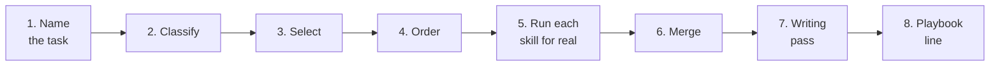

#  playbook

> **How to read this**
>
> - **Agents:** Follow **Agent guardrails** and the **Core procedure** literally. A skill you select gets run — its full procedure, to its own output contract. Naming a skill in the closing line without having run it is the one unforgivable output of this skill.
> - **Humans:** Say "run the playbook" and hand over the task. Open `references/roster.md` when you want to see what the router can select, and `references/worked-example.md` for one full run.
> - **Index:** [`references/README.md`](references/README.md) · **Public overview:** [`README.md`](README.md)

**Not a substitute for the skills it routes to.** This skill selects, orders, and merges. The judgment inside each stage belongs to the selected skill, run on its own terms — see **Agent guardrails**.

## What this skill is

A playbook collection only pays when its skills get used. Left to memory, they do not: the owner has to recall which skills exist, name the relevant ones task by task, and hope the naming was complete. Every task that arrives without names gets whichever skills happen to be in the room's head that day — usually none, or the same two favorites.

This skill is the router that removes the naming step. Given a task, it classifies what kind of task it is, selects the playbook skills whose trigger conditions the task matches, runs those skills in the order the collection is built to run in, and merges their outputs into one deliverable. The owner stops being the index. The task itself pulls the skills it needs.

Three habits do the work. Selection is written down — which skills matched, which were considered and skipped, and why — so a wrong selection can be argued with, not just felt. The order is fixed — understand before decide, decide before position, position before plan, plan before say — because later skills in this collection consume earlier skills' outputs, and running them out of order produces work that has to be redone. And every run closes with the playbook line: the skills that ran, in order, and what each one changed in the output. A run that cannot write that line did not run the playbook. It mentioned it.

## When to use

Use this skill when:

- **The owner says "run the playbook"** — or any plain equivalent: "use the skills," "run it through the playbook," "apply everything relevant."

- **A substantive task arrives with no skills named** — a decision to make, a system to fix, a launch to plan, a position to set, a piece of content to produce — and the task's shape matches more than one skill's triggers.

- **A task spans the collection's joints** — it needs understanding and a decision and words, or a position and a plan — and no single skill covers the whole of it.

- **A past output feels thin** and the suspicion is that a relevant skill never ran on it. Re-running the task through the router is the check.

## When NOT to use

- **Not for trivial or single-step tasks.** A quick factual answer, a lookup, a one-line fix, a status check: no skills are needed, and the router's correct move is to say so and stand down. Routing everything is how a router becomes overhead.

- **Not when the owner names the skills.** A named list is an instruction, not a gap. Run exactly what was named, in the router's order if more than one was named, and say that is what happened.

- **Not as a substitute for a skill's own trigger.** When a task plainly matches one skill and nothing else — a cold email to write, a channel episode to produce — run that skill directly. The router adds value at the joints, not inside a single room.

- **Not to decorate finished work.** Running the playbook over an output that is already decided, to make it look thorough, is the failure mode this skill exists to prevent, pointed the other way.

## Agent guardrails

1. **Stand down on trivial tasks.** If the task is single-step, factual, or reversible at no cost, say the router is not needed and do the task directly. Cost discipline is a feature: a router that fires on everything teaches the owner to stop invoking it.

2. **Run what you select, for real.** A selected skill's procedure is executed in full, to its own output contract — its steps, its evidence rules, its verification checklist. A summary of what the skill *would* say is not a run. If a selected skill cannot be run — its inputs are missing, its evidence base does not exist — the run says so at that step and names what is missing, instead of improvising the skill's voice.

3. **Never run a skill as decoration.** Every selected skill must change something in the merged output: a verdict, a number, a structure, a cut, a gate result. If a skill ran and changed nothing, the closing line says that too — and the selection step learns from it.

4. **Selected skills keep their own gates.** A skill's guardrails, gates, and hard rules bind the merged run exactly as they bind a solo run. The router never overrides them for the sake of the merge: a publish gate still gates, an evidence rule still excludes, a trade-off gate still fails an empty record.

5. **Conflicts resolve by boundary, or surface.** Each skill's limits section names what it owns and what it does not. When two outputs conflict, the owning skill's version stands — positioning owns the position, comms owns the words, the plan owns the split. When no boundary covers the conflict, it is surfaced to the owner with both versions and the router's recommendation. It is never silently averaged away.

6. **Never invent a skill.** The router selects only from the roster in `references/roster.md`. A task shape no roster skill covers is named as a gap in the closing notes — it is not filled by an improvised procedure wearing a skill's name.

7. **Selection is auditable.** The working notes record every skill considered, the verdict (ran / skipped), and the reason in one line each. The notes are part of the run's record, available whenever the owner asks why the output looks the way it does.

8. **The writing pass is a step, not a style.** The merged deliverable goes through the writing pass the selected skills require — the work-humanizer skill in rewrite mode, then the writing-styles plain rules — on the exact text being delivered. Facts, figures, quotes, and verdicts never change in the pass. The register does.

## The one idea

**The task pulls the skills. The owner should never have to name them.**

Everything else in this file is that sentence made operational: the roster, the fixed order, the merge rules, and the closing line that proves the run happened.

## The roster

The router selects from the Made Man Playbooks. The summary below is the selection surface; the full roster — what each skill owns, its trigger conditions, what it consumes, what it hands off — lives in [`references/roster.md`](references/roster.md). The roster is a living list: a newly published playbook skill is added to it in the same pass that installs the skill.

| # | Skill | Owns, in one line | Runs at |
| --- | --- | --- | --- |
| 1 | first-principles-thinking | Stripping a decision, design, or cost to truths that carry evidence, and rebuilding from the floor | Understand |
| 2 | fix-the-bottleneck | A running system's one constraint, and the order to relieve it in | Understand |
| 3 | psychological-profiling | An evidence-graded profile of a person, from their own public words and record | Understand |
| 4 | game-theory-for-decisions | Outcomes that depend on other actors' choices | Decide |
| 5 | fundraising | Raising capital, or selling a business, as a competitive process | Decide |
| 6 | due-diligence | What is verifiably true about a person or company, checked against the public record | Decide |
| 7 | positioning | What a company or product will be thought of as | Position |
| 8 | business-model-canvas | How a business makes money, stated and tested on one sheet | Position |
| 9 | vision-and-manifesto | A vision, mission, or manifesto that changes real decisions | Position |
| 10 | one-page-marketing-plan | The whole marketing system on one page | Plan |
| 11 | cold-outreach | First messages to people with no prior relationship | Plan |
| 12 | funnel-operator | A video channel run as a system, episode after episode | Plan |
| 13 | comms | Public moments, and how a thing is said | Say |
| 14 | write-in-your-voice | Drafting in a named person's real voice, built from their speech | Say |
| 15 | stop-the-scroll | Whether content earns attention: the hook and the call to action | Say |
| 16 | storytelling | Narrative structure, the hook, and what every scene is for | Say |
| 17 | cartoon-system | Recurring-character illustration: character bibles, panel grammar, drift checks | Say |
| 18 | interview-yourself | Content drawn from a person's own lived experience, by interview | Say |
| 19 | podcast-yourself | A talking-head video prepped from counted results and documented receipts: the riff sheet and the edit brief | Say |
| 20 | playbook | This router: selection, order, merge, and the closing line | — |

Two standing support skills sit outside the routed roster and are called by the writing pass in step 7 of every run: **work-humanizer** (rewrite mode) and **writing-styles** (the plain rules). They are not selected per task. They are how every merged deliverable gets finished.

## Core procedure

Run all eight steps, in order, on **one** named task.

### 1 — Name the task

Write down, in one sentence: the **task**, the **deliverable** it must produce (a decision, a document, a plan, a draft, a fix), and the **outcome** that defines success — the number, verdict, or state the deliverable must reach. If the task cannot be stated in one sentence, split it until it can, and route each piece. A vague task routes vaguely: "handle the launch" selects everything and therefore nothing.

### 2 — Classify the task

Read the task against the roster's trigger conditions in `references/roster.md`. Classification asks what the task *is*, in the collection's own shapes: Is a decision being made under a cost nobody can explain? Is a running system underperforming? Does the outcome depend on another actor's move? Is something being said in public? Is a channel, a plan, a position, an outreach involved? A task normally matches several shapes. That is expected — the router exists for tasks that match more than one.

### 3 — Select, and write the selection down

Select every skill whose triggers the task matches. Then record, in the working notes, the full consideration list: each roster skill, ran or skipped, with a one-line reason. Skips need reasons as much as runs do — "fundraising: skipped, no raise or sale in this task" is a selection doing its job. Two failure shapes live at this step: selecting a favorite that does not match (decoration, guardrail 3) and missing a match because the task's wording hid its shape (a "quick announcement" that is actually a repositioning — positioning was the match, and comms alone would have written words for a position nobody had set).

### 4 — Order the selected skills

Run the selected skills in the collection's fixed order:

1. **Understand** — first-principles-thinking, fix-the-bottleneck, psychological-profiling. What is true, what it costs at the floor, where the running system actually loses its output, and who the person across the table is, from their own record.

2. **Decide** — game-theory-for-decisions, fundraising, due-diligence. What to do, given that other actors move too, given the money process where money is being raised or a business sold, and given what the public record verifies about the parties.

3. **Position** — positioning, business-model-canvas, vision-and-manifesto. What the thing will be thought of as, how it makes money, and what it stands for — in that order inside the phase, because the canvas and the vision both lean on the position.

4. **Plan** — one-page-marketing-plan, cold-outreach, funnel-operator. The system that carries the position to market: the plan, the first messages, the channel.

5. **Say** — comms, write-in-your-voice, stop-the-scroll, storytelling, cartoon-system, interview-yourself, podcast-yourself. The words and the pictures: the moment named and said plainly, in the owner's voice where the voice is the owner's, with a hook that earns the attention, a story shape that holds it, a recurring character drawn the same in every frame, and — for launches — the owner's own answers as the only source. A talking-head video gets its riff sheet here: the counted shapes and the sorted claims, built into beats the performer can riff from and the edit can weave.

The order is load-bearing because the collection is built as a chain of consumption: the marketing plan consumes the positioning record, the channel config consumes the position, comms says a position it does not set. A skill later in the order that finds its input missing does not improvise it — it sends the run back to the earlier skill that owns it.

### 5 — Run each selected skill for real

Execute each selected skill's own core procedure, in order, on the task. Each run produces that skill's own output contract: the decomposition with its floor math, the constraint verdict, the game map, the positioning record, the nine squares, the episode package, the statement. The selected skill's guardrails and verification checklist apply inside its run. Where a skill's procedure calls a sibling — positioning calling comms at the statement step, the plan calling business-model-canvas at its economics — the call is honored as part of that skill's run, and noted in the working notes.

### 6 — Merge into one deliverable

Assemble the selected skills' outputs into the single deliverable the task named in step 1. The merge is an edit with rules, not a concatenation:

- **One verdict, stated once.** Where several skills reach the same conclusion, the deliverable states it once and lets the reasoning sit below it.

- **Boundaries decide overlaps.** Each skill's contribution stays inside what it owns. The position in the deliverable is positioning's record, word for word in its load-bearing fields. The words that carry it are comms'. The split is the plan's.

- **Numbers keep their labels.** Every figure carries the label its own skill gave it — measured, documented, declared, estimated — through the merge. A merge that blends an estimate into a fact has corrupted the run.

- **Conflicts surface or resolve by boundary** (guardrail 5). A resolved conflict is noted in one line. An unresolved one goes to the owner as an open item, with both versions.

### 7 — Run the writing pass

Run the pass the selected skills require, over the merged deliverable: work-humanizer in rewrite mode first, then the writing-styles plain rules — short sentences, one idea each, numbers spoken the way a person says them, bold only on the few facts that matter. Evidence, verdicts, figures, and quotes do not change. A deliverable that skips this step ships in the register of whichever skill ran last, and the owner reads a committee memo instead of an answer.

### 8 — Close with the playbook line

End the deliverable with the playbook line, in this shape:

> **Playbook:** first-principles-thinking (the floor math that set the verdict) → fix-the-bottleneck (named the funnel, not the content, as the constraint) → positioning (both records; one passed the gate, one parked). Skipped, with reasons in the working notes: fundraising, cold-outreach.

One clause per skill that ran, naming what it changed. Then the skips that matter — the near-misses a reader would wonder about. The line is the run's receipt: it lets the owner check the selection, spot a skill that should have run, and trust that the ones named actually did.

## Calls on sibling skills

This skill's sibling calls are the whole roster — that is its nature, and the calls are the Core procedure, not a list appended to it. Two standing calls sit outside the selection step:

- **At step 7, call work-humanizer and writing-styles** — the writing pass runs on every merged deliverable, whichever skills were selected.

- **At any step, when a selected skill calls its own siblings, honor the call** — the router does not flatten the collection's internal calls into its own selection. A skill's named call is part of that skill's procedure, and running the skill means running its calls.

## Output contract

Every run returns:

1. **The deliverable** — the one thing the task named in step 1, merged from the selected skills' outputs, writing pass applied. This is the bulk of the return and the only part most readers need.

2. **The playbook line** — closing the deliverable, in the step 8 shape: skills that ran, in order, one clause each on what they changed, plus the skips that matter.

3. **The working notes** — held with the run's record, produced on request: the task sentence, the full consideration list with ran/skipped verdicts and reasons, each selected skill's raw output before the merge, any conflicts and how they resolved, and any roster gaps the task exposed.

A run that stands down under guardrail 1 returns the task's answer directly, with one line saying the router stood down and why. That line is not a playbook line and does not pretend to be one.

## Limits and boundaries

- **The router adds no judgment of its own.** Inside a stage, the selected skill's method governs. Where the router's summary of a skill and the skill itself disagree, the skill wins and the roster entry gets fixed.

- **Selection quality is the router's whole risk.** A missed match produces a confident deliverable missing the one analysis that mattered. The written consideration list exists so the miss is visible and correctable — by the owner, or by the next run.

- **The roster ages.** Skills are added, revised, and retired. A roster entry that no longer matches its skill's frontmatter description is a defect: the roster is re-read against the skills whenever a skill is added or a version changes, and the verify script checks that every named skill exists.

- **Cost is real.** A full run executes several procedures end to end. The stand-down rule (guardrail 1) and the named-skills rule (When NOT to use) are the cost controls. A run whose task did not warrant its cost is a router failure even when the deliverable is good.

- **One task, one run.** A run covers the task named in step 1. New tasks discovered inside a run — the funnel the channel exposed, the position the announcement needs — are named as follow-ups in the working notes, not silently absorbed into the run's scope.

## Verification checklist

Before a run is called done, confirm:

- [ ] The task was named in one sentence, with its deliverable and success outcome.

- [ ] The consideration list exists: every roster skill marked ran or skipped, each with a one-line reason.

- [ ] The selected skills ran in the fixed order — understand, decide, position, plan, say — and each consumed the earlier outputs it is built to consume.

- [ ] Every selected skill was run to its own output contract, not summarized, and its guardrails and gates were honored inside the run.

- [ ] Nothing in the merged deliverable rests on a skill that was only named.

- [ ] Conflicts were resolved by the owning skill's boundary, or surfaced to the owner as open items.

- [ ] Every figure in the deliverable carries its evidence label from the skill that produced it.

- [ ] The writing pass ran on the exact text delivered.

- [ ] The playbook line closes the deliverable: skills in order, one clause each on what changed, and the skips that matter.

- [ ] If the router stood down, the return says so in one line and carries no playbook line.
