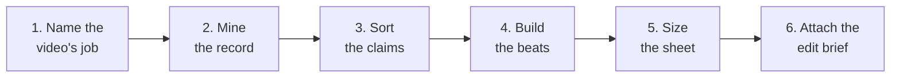

#  podcast-yourself (open skill)

**A prep method that turns a founder's proven content and documented receipts into a sequential riff sheet for a talking-head video — one question per beat, the receipt to hit, the line to land — plus the edit brief that cuts the single take for retention, sound bites first.**

Most talking-head videos are filmed from a topic list and edited on hope. The performer finds the thread live, on camera, in the minutes the viewer uses to leave; the best line of the day lands at minute twenty-two. This skill replaces the topic list with a sheet built from evidence: the performer's own counted results say which shapes the audience already rewards, the claim sort says which results the performer may say out loud, and the beats are built to stand alone so the edit can open with the sound bites and weave the rest for attention. The performer riffs. The structure was decided before the camera rolled.

##  What this is

The skill in one paragraph: name the video's one job, mine the performer's recent content counts and name the winning and losing shapes, sort every claim into said-by-the-performer or needs-a-witness, build the beats (turn, proof of life, receipts, method, quest, invitation, callback close) in the four-line format, size the sheet to the target length, and attach the edit brief — transcribe, cut the fillers, cold open from the flagged sound bites, weave for retention, verify against the sheet.

What it is built on: the observation that a performer should never have to invent and perform at the same time. A script removes the cost of inventing by removing the life; a topic list removes neither cost. The riff sheet removes the inventing cost and raises the density of landable lines, because every beat was traced to a counted result or a documented receipt before it earned its place.

The deliverable is the sheet, not advice about the sheet. A run ends with three things: the riff sheet the performer films from, the edit brief the footage will be cut under, and an evidence note that shows the counts, the sort, and the cuts — so the next video's prep starts from a stronger record than this one did.

##  Who it is for

| Reader | What you get |
|---|---|
| A founder filming a launch, a result, or a change of direction | A sheet that opens with your strongest proven shape and keeps every claim inside your record |
| A creator with a back catalogue | Your own counts, turned into a shape list — what to double down on and what to stop filming |
| An operator or chief of staff prepping a principal | A four-line beat format a non-writer can build, and an evidence note that shows the work |
| An agent running the prep | A literal procedure with guardrails: counts before taste, receipts or silence, one question per beat |

##  Process at a glance



One job, stated in a sentence. One record, mined and ranked. One sort, claims in or out. Then the beats: turn, proof of life, receipts, method, quest, invitation, callback close — each a bridge, a question, a hit, a land line, and a flag, spaced to be read at a glance on camera. The sheet is sized to the target length by deepening proven shapes before adding new ones, and the run closes by attaching the edit brief in its fixed order: transcribe, cut, cold open, weave, verify.

##  How to use with an agent

| You want | Say |
|---|---|
| A riff sheet for a launch video | "Run podcast-yourself for the launch video. The job is [one action]. Target length [minutes]." |
| To know what to double down on | "Mine my last month of posts and name the winning shapes before you draft anything." |
| A long video's structure | "Size the sheet for thirty minutes. Expand the method beat before adding beats." |
| The edit brief for footage already filmed | "Attach the edit brief to this sheet, with the cold-open candidates flagged." |

The agent will ask for the video's job and the performer's content record if it cannot reach them. Everything else — the ranking, the sort, the beat order — the method decides, and the evidence note shows.

##  Folder map

```
podcast-yourself/
  SKILL.md            the method: guardrails, the six steps, the output contract
  README.md           this file
  CHANGELOG.md        version history
  assets/icons/       the icon set used across the playbook
  references/
    README.md         the references index
    worked-example.md a finished riff sheet, start to close
    the-edit-brief.md the five-step edit order the brief attaches
  scripts/
    verify.py         structural checks for this package
```

##  Sources and credits

The method synthesises: the retention discipline of high-output video creators — the cold open and the first-thirty-seconds rule are practitioner craft, stated as practice in the skill, not as studied fact; the claim sort and the founder-speaks rule from the comms playbook in this collection; the shape-testing backbone from stop-the-scroll; the doorway close from fundraising's process discipline. The four-line beat format and the mine-then-sort order are this skill's own. No third-party text is reproduced.

##  Contributing

Improvements are judged by one test: does the change make the next sheet easier to film from, or easier to verify? Open an issue or a pull request against the repository. Keep the beat format and the output contract stable unless the change carries a field case showing the current form failing.

##  License

MIT. Use it, adapt it, ship your own version — keep the license notice with it.

##  Version

0.2.0 — renamed to Podcast Yourself (formerly Tee Up the Take); the method is unchanged. See `CHANGELOG.md`.

## Get the skill

Copy the `podcast-yourself/` folder into your agent's skills directory, or point your agent at this repository and tell it to install the skill by name. Then give it a video to prep.
