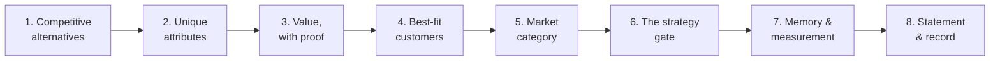

#  positioning (open skill)

**How to decide what a product will be thought of as — on buyer evidence, in a fixed order, with proof attached.** Work the five components in sequence: what buyers would do instead, what the product uniquely has, what that is worth with the proof shown, who cares most, and only then which category frame makes the value obvious. Pass the result through a strategy gate that demands named trade-offs and separates table stakes from real differences. Ship a positioning record built to be remembered — the owned concept, the category, the named alternatives, the best-fit customers, and the trade-offs — ready for a marketing plan to consume directly.

##  What this is

An open skill that an AI agent can run, for the decision most companies never actually make: what position they own in their buyers' minds.

Positioning usually fails in one of two directions. The inside-out version starts from the product: a category picked for glamour, a list of benefits nobody can check, a target customer wide enough to refuse no one — and a market that responds by filing the company under someone else's frame. The folklore version starts from slogans: be first, own a word, create a category and take its crown — claims whose evidence, where it was ever examined, was picked after the winners were known. This skill takes the disciplined middle. The alternatives come from what buyers would actually do, including nothing. Value enters the record only with proof a buyer can check. The category is chosen last, because it is a frame for value that must exist before it can be framed. And no position ships until it names its trade-offs, because a position that refuses nothing is a description, not a strategy.

Underneath the procedure sits the measured evidence on how buying works: brands grow by being thought of, by more category buyers, in more buying situations. So the record this skill returns is built for memory as well as for argument — an owned concept in buyers' own words, the buying situations it must attach to, the distinctive assets that will carry it, and the measures that will say whether it is landing.

It answers three questions:

1. Against what buyers would really do instead, what does this product uniquely have — and what is that worth, with the proof shown?
2. Who cares most, narrowly enough to win first — and what will the company refuse, in customers and in offers, to hold the position?
3. In which buying situations must buyers think of this brand, and how will anyone know whether they do?

The skill runs standalone for a launch, a repositioning, or a new segment, and its output record is the input its sibling skills expect: the one-page-marketing-plan skill takes the record's chain-out block as its message square, comms says the position in public moments, and fundraising borrows it whole for a raise.

##  Who it is for

| Reader | What they get |
| --- | --- |
| Founders before a launch or repositioning | A position decided once, on buyer evidence, instead of re-argued in every deck and page the company ships |
| Product marketers and marketing leads | A fixed procedure with a gate: alternatives, attributes, proved value, best-fit customers, category last — and a record the rest of the plan consumes without re-derivation |
| Sales-led teams losing to "no decision" | The status quo named as the competitor it is, and a position stated against it before it is stated against any product |
| Agents running strategy work for a human approver | An output contract: a positioning record with the chain-out block first, the proof attached claim by claim, the trade-offs named, and the evidence gaps stated plainly |

##  Process at a glance

##  How to use with an agent

| Step | What to give the agent |
| --- | --- |
| Name the decision | The launch, repositioning, or segment this run serves, and what a decided position would unblock |
| Hand over the buyer evidence | Win/loss accounts, sales-call recordings, customer language, lost-deal notes — the rawer the better; the agent works the components from evidence, not from the team's beliefs |
| Expect the order to be enforced | Alternatives before attributes, attributes before value, value before customers, category last — a run that starts with a category is restarted |
| Sit for the gate | The trade-offs discussion is the decision: customers not served, offers not made, deals walked away from. Nothing ships with those fields empty |
| Take the record, not a slogan | The return carries the chain-out block for the marketing plan, the proof per claim, the entry points and asset audit, the completed statement as a completeness check, and the measures and gaps |

##  Folder map

| Path | What it holds |
| --- | --- |
| `SKILL.md` | The objective, the framing axiom, the eight-step procedure, the resolved tensions, guardrails, the output contract, and limits |
| `references/README.md` | Index of the depth material |
| `references/the-five-components.md` | The five components plus the optional trend, in full: evidence sources, the failure each component catches, and the handoff tests between them |
| `references/memory-and-measurement.md` | The buying-behavior layer: category entry points, the Fame × Uniqueness asset audit, the measures for whether a position is landing, and the counter-data note |
| `references/the-strategy-gate.md` | The gate in full: trade-offs and activity fit, parity versus difference, the whole-product test, the onlyness forcing exercise, and the convergence warning |
| `references/worked-example.md` | A composite worked example: a job-costing tool repositioned out of a borrowed frame, from alternatives to the shipped record |

##  Sources and credits

The method core is April Dunford's five-component positioning method (*Obviously Awesome*, 2019; *Sales Pitch*, 2023) — a practice framework, labeled as such, whose components are each checkable against customer evidence. The objective and the memory layer rest on the Ehrenberg-Bass Institute's measured buying-behavior research: Byron Sharp's *How Brands Grow* (2010; Part 2, 2015) and Jenni Romaniuk's *Building Distinctive Brand Assets* (2018) and category-entry-point work. Segment discipline and the output statement come from Geoffrey Moore's *Crossing the Chasm* (1991; 3rd ed. 2014). The gate is Michael Porter's ("What Is Strategy?", *Harvard Business Review*, 1996) trade-offs and activity fit, with Kevin Lane Keller's points-of-parity versus points-of-difference test (1993) run inside it. The framing axiom — a position lives in the prospect's mind — is Ries and Trout's (1981), used as framing and labeled as such; their "laws" are not used as rules, and sources whose evidence did not hold up (category-creation economics drawn from winners picked after the fact; value innovation on a dataset never shown; an unfalsifiable company typology) are named in the skill's limits as roads not taken, with the reasons. No source text is reproduced.

##  Contributing

Improvements are welcome. The bar is the same as the method: a proposed change names its evidence — a run where a component failed in the field, buyer data that contradicts a step, a measure that did not move when the position did — and scored runs (a record, its measures, and what the market did) are the most valuable contribution there is.

##  License

MIT. See the repository LICENSE file.

##  Version

0.1.0 — first build: the five components as the procedure, the strategy gate, the memory layer, and the positioning record as the output contract. See `CHANGELOG.md`.
