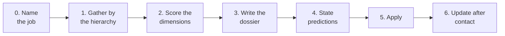

#  psychological-profiling (open skill)

**How to build a profile of a person before you deal with them, from their own words and their record, with the evidence shown.** Governments have done this for eighty years before summits and negotiations. This skill does the business version: before you write to someone, meet them, or negotiate with them, you build a short profile that says what they want, how they decide, and how they talk. Every claim in it shows its evidence and how sure you should be.

##  What this is

An open skill that an AI agent can run, for the moment before first contact with a person who matters: a cold outreach target, a meeting you have to get right, a negotiation.

Most profiling you can buy is one of two things. A type label from a quiz the person never took. Or a confident write-up with no evidence shown, the way television profilers talk. This skill takes a different approach, borrowed from the one place profiling was a serious craft: the unit the CIA built to profile foreign leaders before summits. Its methods were later published, and the good ones are scored systems that run on a person's own words. This skill runs those, grades every claim, and answers three questions:

1. What can a person's own words and choices actually tell you, and how much is it worth?
2. Which of the famous profiling methods hold up, and which are theater?
3. How do you write the read down so it can be checked, scored, and corrected after you meet the person?

The profile is built from the person's spoken words first, because speech is the hardest thing to fake. Video and podcast interviews, panels, calls. Written posts count for less, because posts can be ghostwritten. What the person has actually done — built, bought, funded, left — counts most of all when it disagrees with their words.

##  Who it is for

| Reader | What they get |
| --- | --- |
| Founders writing to people they cannot afford to get wrong | A profile that picks the angle, the proof, and the ask for one specific person |
| Anyone walking into a meeting that matters | A one-page prep sheet: what they want, how they decide, what to say, what to avoid |
| Negotiators and deal-makers | Predictions about the other side, written down before the meeting, scored after it |
| Agents building dossiers for a human approver | An output contract: sources by tier, scored dimensions with confidence, the dossier, dated predictions, and the gaps stated plainly |

##  Process at a glance

##  How to use with an agent

| Step | What to give the agent |
| --- | --- |
| Name the decision | The outreach, meeting, or negotiation this profile serves, and what a good outcome looks like |
| Point it at the words | Links to interviews, podcasts, talks, or transcripts of the person speaking; their writing if speech is thin |
| Let the hierarchy run | The agent ranks sources by how hard they are to fake and says when the evidence is too thin for a full dossier |
| Read the dossier, not a label | The return carries the scored dimensions with their evidence and confidence, the one-page dossier, and predictions you can check |
| Score it after contact | Tell the agent what the person actually did; the profile gets corrected, and its predictions get graded |

##  Folder map

| Path | What it holds |
| --- | --- |
| `SKILL.md` | The seven-step procedure, guardrails, output contract, and limits |
| `references/README.md` | Index of the depth material |
| `references/the-evidence.md` | The graded evidence: the CIA tradition, the scored methods, the language research, and the methods that failed checking |
| `references/scoring-the-dimensions.md` | How to score each dimension from words and record: what to look for, how to state it, how to set confidence |
| `references/dossier-format-and-example.md` | The one-page dossier template, and a worked example built from published research |

##  Sources and credits

The method rests on published work. The at-a-distance tradition: Jerrold Post's CIA Center for the Analysis of Personality and Political Behavior and his 2003 volume *The Psychological Assessment of Political Leaders*, which publishes the center's methods. The scored systems inside it: Margaret Hermann's Leadership Trait Analysis, David Winter's motive scoring, and Peter Suedfeld's integrative complexity work. The personality anchor: the Big Five literature. The language research: Kosinski, Stillwell and Graepel (2013) and Youyou, Kosinski and Stillwell (2015) on reading personality from digital records, and Matz, Kosinski, Nave and Stillwell (2017) on matching messages to personality. The cautionary record: Snook and colleagues (2008) on criminal profiling's weak evidence, and the American Psychiatric Association's Goldwater rule on diagnosing at a distance. Full grading: `references/the-evidence.md`. These are paraphrases and adaptations, credited; no source text is reproduced.

##  Contributing

Improvements are welcome. The bar is evidence: a proposed change names its study or dataset, its size, and its year — or is labeled practice and argued on those terms. Scored profiles are the most valuable contribution there is: a dossier, its predictions, and what the person actually did.

##  License

MIT. See the repository LICENSE file.

##  Version

0.3.14 — fourteenth build: a non-obviousness bar on predictions, at writing and at scoring. See `CHANGELOG.md`.
