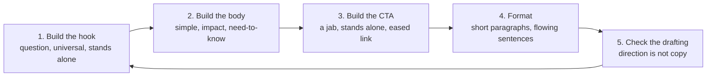

#  stop-the-scroll (open skill)

**A procedure for building content whose ends do the work.** This skill hardens AIDA where pieces actually die: the hook and the call to action, each built to stand out in a sea of 100 competing pieces and to stand alone with full context, over a middle that is universal, relatable, and about impact.

##  What this is

An **open, agent-oriented skill** for any copy that must earn attention in a feed: launch posts and threads, video scripts and outlines, landing pages, announcements.

Most content advice treats a piece as one thing. This skill treats it as three, with different standards for each:

1. The hook must stop a scroll and survive being screenshotted alone.
2. The body must be feelable by a reader outside the field, with every number carrying its why.
3. The call to action must land like a jab and work as its own complete post.

The frame is AIDA, the oldest structure in advertising. The thirteen principles are newer: they were distilled from a single launch session in which one piece of copy went through fourteen versions, and every rejection added a rule. The case study in the references tells that story.

##  Who it is for

| Reader | What they get |
| --- | --- |
| Founders launching in public | A build order (ends first) and two tests that catch a dead launch before the feed does |
| Creators and marketers | A principle-by-principle review standard for drafts, with the rebuild order stated |
| Agent fleets writing content | Guardrails against the classic machine failures: announcement openings, bare numbers, abrupt link drops, and the author's side comments pasted into copy |
| Anyone whose posts get read and forgotten | A call to action built to be screenshotted, not scrolled past |

##  Process at a glance

##  How to use with an agent

| Step | What to give the agent |
| --- | --- |
| Point it at the piece | The draft or the raw material, the channel, and where the link should land |
| Let it build the ends first | Hook and call to action drafted and tested before the body is written |
| Read the two tests per end | Sea-of-100 and stand-alone verdicts, one line each, for the hook and for the call to action |
| Check the cut list | Material removed under need-to-know is named, so nothing you wanted dies silently |
| Keep direction out of copy | Your examples and asides steer the draft; they are never pasted into it |

##  Folder map

| Path | What it holds |
| --- | --- |
| `SKILL.md` | The five-step build procedure, the thirteen principles in brief, guardrails, output contract, and limits |
| `references/README.md` | Index of the depth material |
| `references/the-13-principles.md` | Each principle in full: the rule, why it exists, the failure it prevents, and its quick test |
| `references/hook-and-cta-patterns.md` | Construction patterns for hooks and calls to action, and how to run the two tests |
| `references/case-study-bottleneck-launch.md` | The fourteen-version launch session the principles were distilled from, with the final copy |
| `references/sources-and-urls.md` | AIDA's lineage and the session credited as the primary source |

##  Sources and credits

The frame is AIDA (attention, interest, desire, action), traced to E. St. Elmo Lewis around 1898 and set down in print by E. K. Strong, *The Psychology of Selling and Advertising* (1925). The thirteen principles are the author's own, distilled from the launch session recorded in the case study: every principle on the list exists because a draft died without it. Full table: `references/sources-and-urls.md`. No source text is reproduced beyond short attributed formulations.

##  Contributing

Improvements are welcome. Field reports are the most valuable contribution: a piece built under the skill, the two tests' verdicts on its ends, and what the feed did with it. A proposed principle needs a dead draft behind it; that is how the existing thirteen got in.

##  License

MIT. See the repository LICENSE file.

##  Version

0.1.3 — current. See `CHANGELOG.md`. See `CHANGELOG.md`.
