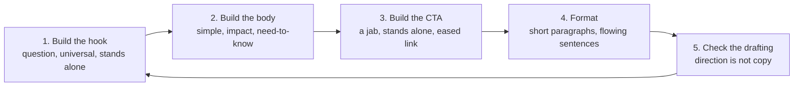

#  stop-the-scroll

> **How to read this**
>
> - **Agents:** Follow **Agent guardrails** and the **Core procedure** literally. Build the ends first. A piece whose hook or call to action cannot stand alone is not finished, whatever the middle looks like.
> - **Humans:** Run the two stand-alone tests on anything you are about to publish: screenshot the hook alone, then the call to action alone. If either needs the rest of the piece to make sense, rebuild that end.
> - **Index:** [`references/README.md`](references/README.md) · **Public overview:** [`README.md`](README.md)

**Not a substitute for voice or judgment.** This skill governs how a piece of content is *built*. It does not govern how the author sounds (that is the voice skill's job, where one exists) or whether the piece should exist at all (that is a communications decision). See **Limits and boundaries**.

## Sources

Full credit table: [`references/sources-and-urls.md`](references/sources-and-urls.md). The frame is AIDA (attention, interest, desire, action), the oldest structure in advertising, traced to E. St. Elmo Lewis around 1898 and set down by E. K. Strong in 1925. The thirteen principles that harden its ends were distilled from a single launch session in November 2026, in which one piece of launch copy went through fourteen versions and every rejection added a rule. The worked record is in [`references/case-study-bottleneck-launch.md`](references/case-study-bottleneck-launch.md).

## When to use

Use this skill when a **founder**, **marketer**, **creator**, or delegated agent is building or reviewing:

- A **launch post or thread** (X, LinkedIn) for a product, a skill, a feature, or an idea.
- A **video script or outline** (YouTube, short-form) where the first line decides whether anyone stays.
- **Website or landing copy** whose first screen and final call to action carry the whole conversion.
- Any **announcement** that competes in a feed against a hundred other pieces posted the same hour.

## When NOT to use

- **Private or one-to-one writing.** Messages, emails to a known person, and support replies are conversations, not feed content. Different rules govern them.
- **When the author's voice is the open question.** If the piece does not yet sound like its author, fix that first with the voice material; structure applied to the wrong voice produces a well-built piece by a stranger.
- **Crisis or response communications.** Whether to speak, who speaks, and what to admit are communications decisions that outrank construction. Build the piece with this skill only after those decisions are made.
- **Documentation and reference writing.** A reader who arrives with a question needs completeness and order, not a hook. Forcing feed structure onto reference material makes it worse at its actual job.

## Agent guardrails

1. **Build the ends first.** Draft the hook and the call to action before the body. The body is written to connect two ends that already work, never the other way round.
2. **Every end must pass two tests before the piece ships.** The sea-of-100 test: would this line stop a scroll among a hundred competing pieces? The stand-alone test: does this line, screenshotted alone, carry the full context a stranger needs? A line that fails either test is rebuilt, not defended.
3. **Talk to the reader, not at them.** The hook addresses the reader's own problem directly, as a question where the material allows. Announcements about the author are not hooks.
4. **Universal before technical.** Frame the problem so a reader outside the field feels it. If only practitioners can feel the problem, the framing is wrong, not the audience.
5. **No bare numbers.** Every metric in the piece carries its why: the impact, the second-order effect, who waits and what it costs. A number without its consequence is decoration for insiders.
6. **Name things as what they are.** Use the name a stranger understands on first reading. Internal labels, pet names for systems, and jargon are translated or cut.
7. **Need-to-know only.** Personal facts, backstory, and detail that do not serve the reader's understanding or the piece's action are cut, however interesting they are to the author.
8. **The link is earned, then eased.** The call to action builds to the link in the flow of the piece; the link never lands bare or abrupt. Where the author has a home page that captures the relationship (an email list, an account), link there rather than to a raw repository or file host, and let the link's preview carry the work's own branding.
9. **Direction is not copy.** When the author gives an example ("a jab like saying..."), a name, or a side comment while directing the work, that is instruction about the piece, not text for the piece. Illustrative examples are never forced into copy verbatim. This guardrail exists because it was violated four drafts running in the session this skill was distilled from.
10. **Formatting is part of the build, not a cleanup pass.** Paragraphs of one to two sentences; sentences inside a paragraph flow together; one blank line between paragraphs. One sentence per line is a draft artifact, not a style.
11. **Write the piece plain.** Short words where they carry the meaning, no hype adjectives doing the work the hook should do, and no claim the author cannot stand behind if the piece is quoted back at them.

## The one idea

AIDA's four stages are not equal. In a feed, the middle stages (interest, desire) are where competent pieces are similar: clear, relatable, useful. The ends are where pieces die. A weak hook means the middle is never read; a weak call to action means it is read and forgotten.

So this skill hardens the ends. **The hook and the call to action are each built to stand out in a sea of 100 and to stand alone with full context.** A reader who sees only the hook should feel the problem and want the rest. A reader who sees only the call to action should get the whole idea, its name, and where to get it. The middle's job is narrower and more forgiving: be universal, be about impact, carry only what the reader needs.

The name is the standard: build every end as if it must win against the other ninety-nine pieces in the feed, because it must.

## What a run returns

A **build run** returns:

1. **The piece**, hook, body, and call to action visibly separated in the working draft (they merge into clean copy only in the final form).
2. **The two tests, per end**: the sea-of-100 verdict and the stand-alone verdict for the hook, and the same pair for the call to action, each in one line.
3. **The number audit**: every metric in the piece, with the why that accompanies it in the copy.
4. **The cut list**: material removed under need-to-know, named so the author can restore anything cut in error.

A **review run** returns the piece scored principle by principle (the thirteen in [`references/the-13-principles.md`](references/the-13-principles.md)), each marked pass or fail with the offending line quoted, and the rebuild order: ends before middle, always.

## Core procedure

### 1 — Build the hook

Three requirements, all from the reader's side of the screen:

- **A direct, personal question about the reader's own problem** (principle 1). Talk to them, not at them. The reader should be answering the question in their head before they decide to keep reading.
- **The problem framed as a universal problem** (principle 2). Even when the topic is engineering, or finance, or any specialty: the wait, the waste, the thing everything depends on. Non-specialists must be able to feel it.
- **Built to stand out and stand alone** (principle 3). Sea-of-100: the line competes against the whole feed, not against the author's other drafts. Stand-alone: the line carries its full context; a reader who never sees the rest still gets a complete thought worth having read.

### 2 — Build the body

The middle is universal, relatable, and about impact:

- **Simple, high-level language for multiple audiences** (principle 4). No geeky detail, no math nobody outside the field cares about. The specialist reading it should find it true; the generalist should find it clear.
- **Numbers carry their why** (principle 5). Every metric is followed by its business impact, its second-order effect, who waits and what it costs. Not just the granular goal: what the goal is *for*.
- **Things named as what they are** (principle 6). A software factory, not "my agents"; the name a stranger gets instantly. If a term needs a paragraph to explain, the term is wrong.
- **Only what the reader needs to know** (principle 7). Personal facts that do not serve the piece are cut. The author's full story is not the reader's assignment.

### 3 — Build the call to action

The call to action gets the same hardening as the hook:

- **A jab, not a generic ask** (principle 8). It lands with a point of view, the sharpest true sentence the piece has earned. It must stop the scroll in a sea of 100 other calls to action, same as the hook.
- **It stands on its own as its own post** (principle 9): the idea, the name of the thing, and the link, with full context. A reader who sees only this post can act on it completely.
- **Ease into the link drop** (principle 10). The link arrives as the natural end of the piece's motion, never as a bare label-and-URL landing without a runway.
- **Link where the relationship lives** (principle 11). To the author's own site, where a reader can leave an email, not to a raw repository. The link's preview card carries the work's icon or branding, not the author's photo: the piece promotes the work.

### 4 — Format

- **Paragraphs of one to two sentences** (principle 12). Sentences inside a paragraph flow together as prose; never one sentence per line.
- One blank line between paragraphs. In a thread, each post is a paragraph group, and the hook post and the call-to-action post are each complete on their own (steps 1 and 3).

### 5 — Check the drafting

- **Direction is not copy** (principle 13). Re-read the author's instructions alongside the draft. Anything the author said *about* the piece (an example jab, a naming aside, a side comment) that appears *in* the piece verbatim is removed, unless the author explicitly marked it as copy.
- Read the piece aloud once. The ends should sound like the same person who wrote the middle, and the whole should sound like something said, not something typeset.

## Limits and boundaries

- **Not the voice skill.** A voice skill (for example, write-in-your-voice) governs how an author sounds: cadence, word choice, the sentences the piece is built from. This skill governs how the piece is *built*: which end carries what, in what order, under what tests. Run both: source the language from the voice material first, then build the structure with this skill. Structure cannot rescue a piece written in the wrong voice, and voice cannot rescue a piece with no hook.
- **Not comms.** The comms skill governs founder communications decisions: whether to speak, who speaks, what a moment requires, how a crisis is answered. This skill takes a decided piece and builds it. If the open question is *should this be said*, that skill answers first.
- **No reach is promised.** These principles raise a piece's chance in the feed; they do not control any platform's ranking, and they age as platforms change. The two stand-alone tests are the durable part; specific platform tactics belong in channel playbooks, not here.
- **The tests are for feed content.** A piece designed for a reader who already arrived (a documentation page, an email to subscribers who asked for it) is judged by its own purpose. Applying sea-of-100 hardening to everything flattens writing that was never competing.

## Verification checklist

Before calling a piece done, confirm:

- [ ] The hook is a direct question (or direct address) about the reader's own problem.
- [ ] The problem is framed universally; a non-specialist can feel it.
- [ ] The hook passes the sea-of-100 test and the stand-alone test.
- [ ] Every number in the body carries its why: impact, second-order effect, who waits, what it costs.
- [ ] Every thing is named as what it is, in words a stranger gets instantly.
- [ ] Nothing in the piece is there only because it is true or interesting; everything serves the reader or the action.
- [ ] The call to action is a jab with a point of view, not a generic ask.
- [ ] The call to action stands alone: idea, name, and link, full context.
- [ ] The link is eased into, points to the author's own site, and its preview carries the work's branding.
- [ ] Paragraphs run one to two sentences, sentences flow within them, one blank line between.
- [ ] No illustrative example or side comment from the author's direction appears in the copy verbatim.
