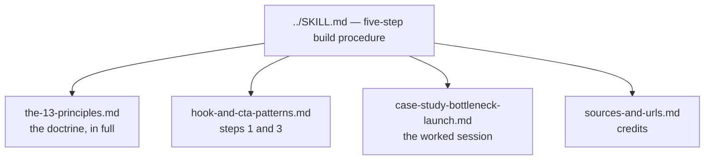

# References index — Stop the Scroll

These references support **stop-the-scroll**, version **0.1.3**. The main `../SKILL.md` holds the five-step build procedure, the guardrails, and the output contract. These files carry the depth: the thirteen principles in full, the construction patterns for the two ends, the session the doctrine was distilled from, and the credits.

| File | What it carries |
| --- | --- |
| `the-13-principles.md` | Each of the thirteen principles: the rule, why it exists, the failure it prevents, and the quick test that checks it |
| `hook-and-cta-patterns.md` | How hooks and calls to action are actually constructed: the shapes that recur, and the procedure for the sea-of-100 and stand-alone tests |
| `case-study-bottleneck-launch.md` | One launch, fourteen versions: what each rejection taught, and the final published copy for X and LinkedIn |
| `sources-and-urls.md` | AIDA's lineage (Lewis, Strong) and the launch session credited as the primary source |
