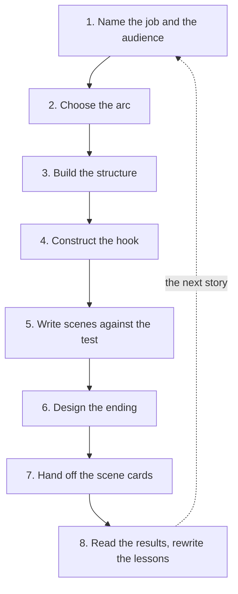

#  Storytelling (open skill)

**Storytelling designs stories that hold — an arc, a structure, a hook, scenes that turn, and an ending that pays — from an evidence base where every lesson carries its label, so you always know whether a choice is standing on data, on a master's practice, or on a useful fiction.**

## What this is

Most story advice arrives with no receipt.

A beat sheet is quoted like a law.

A guru's habit is quoted like a study.

This skill separates the two before it uses either.

Its evidence base, `references/lessons.md`, holds the lessons drawn from the research and the masters — the six emotional arcs measured across more than thirteen hundred novels, the psychology of transportation and tension, twelve thousand screenplays scored by professional readers, the retention rules of the largest video operation on earth, and the science of what gets shared — and every lesson carries its class: measured, practitioner, framing, platform-declared, or observed.

On top of that base sits an eight-step procedure: name the job, choose the arc, build the structure, construct the hook, write scenes against the function test, design the ending, hand off scene cards, and then read the published piece's own numbers back against the lessons it used.

That last step is the point.

Imported lessons are starting capital.

The user's own retention data is the court of appeal, and a lesson it contradicts gets rewritten with the user's data as its new source.

## Who it is for

| Reader | What you get |
|---|---|
| A creator or channel team | Scripts and storyboards designed against retention evidence instead of folklore, with scene cards a producer can build from directly |
| A founder or marketer | Launch stories, talks, and posts whose promises the piece can actually pay, structured to hold to the end |
| An agent operator | A craft layer other skills can call at named steps — a channel operator calls it for scripts and storyboards — with an output contract and a feedback loop |
| A sceptic | Every claim labeled: measured where data exists, practitioner where a master's sample stands behind it, framing where the shape is useful and the data is not there |

## Process at a glance

## How to use with an agent

| Step | What to give the agent | What you get back |
|---|---|---|
| Name the job | The piece, its audience, and what it must do | A one-line job and a named audience, or a question that settles them |
| Design the story | The raw material — facts, footage, a draft, a life | The story design: arc, structure, hook, ending, and the full scene-card set |
| Check the weight | Any design the skill returns | The lessons used, each with its evidence label and source |
| Close the loop | The published piece's retention or response data | A read of the numbers against the design, and any lesson rewritten in `references/lessons.md` with your data as the source |

## Folder map

| Path | Contents |
|---|---|
| `SKILL.md` | The method: guardrails, the one idea, the eight-step procedure, the output contract |
| `references/lessons.md` | The evidence base, labeled lesson by lesson |
| `references/storyboard-method.md` | The scene-card method, with an example card set |
| `references/worked-example.md` | One public story taken through the whole procedure |
| `references/README.md` | The index of the reference files |
| `scripts/verify.sh` | The package check: files, frontmatter, sections, and a label on every lesson |
| `assets/icons/` | The icon set (Hugeicons, free version) |

## Sources and credits

Every source below is used at the evidence class named beside it, and `references/lessons.md` carries the class on each lesson it supports.

| Source | Evidence class |
|---|---|
| Reagan, Mitchell, Kiley, Danforth and Dodds, "The emotional arcs of stories are dominated by six basic shapes," EPJ Data Science, 2016 | measured |
| Matthew Jockers, Macroanalysis, 2013 | measured |
| Green and Brock, "The role of transportation in the persuasiveness of public narratives," 2000 | measured |
| Paul Zak's lab studies, reported in Harvard Business Review, 2014, and Cerebrum, 2015 | measured |
| Loewenstein, "The psychology of curiosity," Psychological Bulletin, 1994 | measured |
| Berger and Milkman, "What makes online content viral?," Journal of Marketing Research, 2012 | measured |
| Stephen Follows with Josh Cockcroft, "Screenplays: Judging by Their Coverage"; Follows' film-industry economics analyses | measured |
| Will Storr, The Science of Storytelling, 2019 | practitioner (synthesis) |
| Robert McKee, Story, 1997 | practitioner |
| The MrBeast production handbook, leaked 2024 | practitioner |
| Paddy Galloway's channel analyses; Colin and Samir's creator interviews and breakdowns | practitioner |
| YouTube Help, "Measure key moments for audience retention" | platform-declared |
| TikTok creative best practices and Creative Codes | platform-declared |
| Kurt Vonnegut's story-shapes lecture; Blake Snyder, Save the Cat, 2005; Aristotle, Poetics; John Truby, The Anatomy of Story | framing |
| Our own reference set: five watched videos, November 2026 | observed |

Icons are from Hugeicons (free version).

## Contributing

Improvements are welcome, under one standing rule: a lesson enters `references/lessons.md` only with its evidence label and its source, and a lesson contradicted by a user's own measured results is worth more rewritten than defended.

Open an issue or a pull request with the change and the evidence behind it.

## License

MIT. See the frontmatter in `SKILL.md`.

## Version

0.1.0 — 2026-11-23. See `CHANGELOG.md`.
