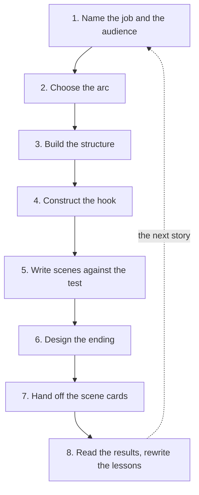

#  Storytelling (open skill)

**Storytelling is the craft layer for narrative work: it designs the story — arc, structure, hook, scenes, ending — from lessons that carry their evidence labels, and hands the design off as scene cards anyone can produce from.**

##  How to read this

`SKILL.md` is the method: the one idea, the eight-step core procedure, the guardrails, and the output contract.

`references/lessons.md` is the evidence base: every lesson the method draws on, grouped by where it applies, each one labeled by how much weight it can bear.

`references/storyboard-method.md` is the scene-card method in full: what a card holds, the function test applied card by card, and how cards become a storyboard.

`references/worked-example.md` is one public story taken through the whole procedure, so a first-time reader can see the method working end to end.

`README.md` is the human-facing overview.

##  When to use this skill

Use it when a piece of content lives or dies on whether the audience stays:

- A video script or storyboard, at any length, in any format.
- A talk, a pitch narrative, or a launch story.
- A written post or article built as a story rather than a list.
- A redesign of a piece that lost its audience partway through.
- A channel or series deciding what shape its stories should take.

##  When NOT to use this skill

- Pure information delivery with no narrative job: a reference page, a spec, a status update.
- Production mechanics — asset generation, editing, upload, scheduling. That is the producer's job; this skill hands them the design. In a channel workflow, the channel operator skill owns production and calls this skill at its script and storyboard stages.
- Copy that must not persuade: compliance text, contracts, factual corrections.
- Inventing a story the facts do not support. The skill shapes true material; it never manufactures events, quotes, or results.

##  Agent guardrails

1. **Every lesson carries its evidence label in any output that uses it.** A lesson drawn from `lessons.md` is cited with its label — measured, practitioner, framing, platform-declared, or observed — wherever the output names or relies on it.
2. **Framing is never presented as data.** A beat sheet, a mythic structure, a lecture shape: these are lenses. The moment an output states one as a finding, it has broken the rule.
3. **The user's own measured results outrank every imported lesson.** When the user's retention data or audience response contradicts a lesson, the data wins, and step 8 of the procedure rewrites the lesson.
4. **No invented statistics.** A number enters an output only with its source and its sample attached. A figure that cannot be traced is cut, not rounded into plausibility.
5. **No invented story material.** Characters, events, and outcomes come from the user's real material. Where a format needs an illustrative pattern, it is labeled illustrative in the output.
6. **The scene test is not waived for favourite scenes.** A scene that does not advance, reveal, or reverse is cut or merged, however well it is written.
7. **The hook's promise is a contract.** The opening may promise only what the piece actually delivers, and the ending must pay it.
8. **Length serves the story's job.** A longer piece is justified by the material and the format, never by the hope that length alone earns watch time or reading time.

##  The one idea

**A story is a model breaking on purpose.**

The audience arrives holding a model of how the world works.

The story's job is to break that model in a controlled way — an unexpected change, a gap they can see and cannot yet fill, a character whose theory of control fails under pressure — and then to rebuild it into a better one by the ending.

Everything in the procedure serves that one motion: choose the shape of the break (the arc), order the breaks so each one raises the stakes (the structure), land the first break in the first seconds (the hook), make every scene turn something (the scenes), and close by answering the break the hook opened (the ending).

The lessons that support each move live in `references/lessons.md`, labeled by evidence.

A lesson without a label does not exist as far as this skill is concerned.

##  Core procedure

Run the steps in order.

Each step names the lessons it draws on; the full text of every lesson is in `references/lessons.md`.

### Step 1: Name the story's job and audience

State, in plain words, what the story must do and for whom.

The job is one of a small set: hold attention to the end, change a belief, move the audience to one named action, or be passed on.

The audience is named as people, not as a demographic: who they are, what model of the world they arrive holding, and what they already care about.

A story with no named job gets no arc; go back and name it.

### Step 2: Choose the arc

Pick one of the six measured shapes and say why it fits the material.

The six shapes, from the computer analysis of more than thirteen hundred novels: rise; fall; fall then rise; rise then fall; rise then fall then rise; fall then rise then fall.

Match the shape to what the material actually does.

A founder's day that starts comfortable, breaks, and ends in a decision is a fall then rise.

A cautionary tale that climbs and then collapses is a rise then fall, and it ends down on purpose.

The measured popularity data favours the complex shapes — rise then fall, fall then rise then fall, and chained shapes — over the plain steady ones, so a simple shape needs a reason.

### Step 3: Build the structure

Lay the beats of the chosen arc across the piece's length and medium.

Scale the beats to the runtime or the reading time: a short piece gets a hook, two or three turns, and the payoff; a long piece gets chapters, each chapter closing one question and opening the next.

Use the labeled templates where they help — a beat sheet is a checklist for finding a missing turn, labeled framing, never evidence.

Raise the stakes in a staircase: each beat beyond the last, with re-engagement beats planted where attention predictably fades — in video, at about the three-minute and six-minute marks.

Check the genre's bargain: what this audience is buying — catharsis, plot, mastery, mystery — decides which beats carry the weight.

### Step 4: Construct the hook

The first seconds carry the whole piece.

The hook does one of three things, in the opening lines: it makes a promise the piece will keep, it opens a tension the audience can feel, or it breaks their model of the world in one clean move.

State the promise plainly and early — no greeting, no branding, no warm-up — and front-load real substance, because the retention data says the largest share of the audience leaves in the first minute.

On short-form, the proposition lands in the first three seconds and the hook inside six.

The hook and the packaging are one promise: the title and thumbnail sell the click, the opening sells the watch, and the opening must match what the packaging led the viewer to expect.

### Step 5: Write scenes against the scene-function test

Write the story as scenes, and test every scene before it survives.

A scene passes only if it does at least one of three things: it advances the story toward its end, it reveals something the audience did not know, or it reverses the direction the story was travelling.

And it must turn a value: something that matters — safety, trust, wealth, control, status — ends the scene in a different state from where it began.

A scene that fails either test is cut or merged into a neighbour, however good it looks on its own.

Build the scenes on causes, not sequences: each scene happens because of the one before it, not merely after it.

Where the material has a central figure, give them a theory of control — a belief about how to stay safe or matter — and let the scenes pressure-test it.

### Step 6: Design the ending

The ending is the beginning's answer.

It pays off the exact promise the hook made, reframed by everything the middle revealed.

Cut on the payoff, not after it: the moment the promise is paid is the last moment, and everything past it spends the goodwill the payoff earned.

An ending that lands down is a complete ending when the arc promised a fall; do not rescue a tragedy the material did not rescue.

### Step 7: Hand off the storyboard as scene cards

Convert the approved story into scene cards, one card per scene, using the method in `references/storyboard-method.md`.

Each card holds: the scene, its function, its turn, its visual, and its line or beat.

The cards are the handoff: a producer, an editor, or a channel operator builds from the cards without re-deciding the story.

Run the function test once more across the full card set before the handoff, because a cut at card stage is cheap and a cut after production is not.

### Step 8: The feedback loop

After the piece is published, read its results against the lessons the design used.

For video, that is the retention curve read in segments — the intro, the top moments, the spikes, the dips — with a named cause for every dip that matters.

For any medium, it is the audience's actual behaviour against the design's predictions: where they left, what they repeated, what they passed on.

A lesson the user's own data contradicts gets rewritten in `references/lessons.md`, with the user's data cited as the new source and its sample stated.

A lesson the data confirms keeps its label; a lesson replaced by the user's data takes the measured label with the user's sample named.

This loop is what makes the skill compound: imported lessons are the starting capital, and the user's own results are the interest.

##  Calls on sibling skills

This skill names its siblings and calls them at set points. It never absorbs their jobs.

- **First principles** — at step 1, when the story's job is unclear: decompose what the piece must actually do before any craft is applied.
- **Positioning** — before step 2, when the story carries a brand or an offer: the story's promise must sit inside the position, and the position's trade-offs decide which stories are never told.
- **Comms** — at steps 4 and 6, on the hook's wording and the closing line: the message discipline that keeps a promise plain and a payoff quotable.
- **Channel operator** — the reverse call: a channel's operator skill calls this skill at its script and storyboard stages, and receives the scene cards at step 7 as its production input.
- **Write in your voice** — wherever the user's own voice carries the piece: the structure comes from this skill, the sentences stay in the user's voice.

##  Output contract

A run of this skill returns a story design with five parts:

1. **The job and the audience** — one or two plain sentences each.
2. **The arc** — the chosen shape, named from the six, with the reason it fits the material.
3. **The structure** — the beat outline scaled to the piece's length and medium, with the re-engagement beats marked.
4. **The hook and the ending** — the opening's first beat in outline, and the closing payoff it answers to.
5. **The scene cards** — the full card set, in the format `references/storyboard-method.md` defines.

Plus one attachment:

6. **The lessons used** — every lesson the design relied on, listed with its evidence label and its source, so the user can see exactly how much weight each choice is standing on.

**The writing pass (binding).** Every human-facing output of this skill is written the way you would say it out loud: short plain sentences, one idea each, active voice, no jargon the audience has not been given.

Numbers in prose are spoken the way a person says them — more than thirteen hundred novels, about nine thousand subscribers — and exact figures live only in tables and source notes.

##  Limits and boundaries

- The evidence base is strongest for written stories and for retention-shaped video. Lessons transfer to other media as judgment, not as findings, and the output says so when it leans on a transfer.
- The measured novel and screenplay studies measure popularity and reader scores, not quality. A shape that downloads well is a bet about audiences, not a verdict about worth.
- The transportation and oxytocin studies ran on written stories and short videos in lab settings. Their direction is consistent across replications and meta-analysis; their size in any one real audience is the user's own data to find.
- Practitioner rules come from the largest stages in their field, and stages differ. A retention rule built for spectacle video is a starting hypothesis for a quiet explainer, not a law.
- Framing sources — the beat sheet, the mythic structures, the lecture shapes — organise thinking. They are never cited as evidence in an output, and this skill will push back if asked to present them as data.
- The skill designs stories from true material. It does not invent testimonials, results, or events, and it does not write a story whose hook promises what the piece cannot deliver.

##  Verification checklist

Before calling a run done, confirm:

- The story's job and audience are named in plain words.
- The arc is one of the six measured shapes, chosen for a stated reason.
- Every scene in the design passes the function test and turns a value.
- The hook makes one promise — promise, tension, or a broken model — inside the opening seconds.
- The ending pays the hook's exact promise and stops there.
- The scene cards are complete enough for a producer to build from without re-deciding the story.
- Every lesson the output relies on is listed with its evidence label and source.
- No number appears without a source and a sample; no framing source is presented as data.
- The output reads the way a person would say it out loud.
