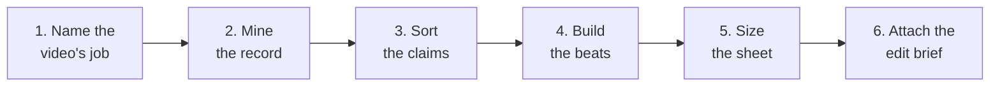

#  tee-up-the-take

> **How to read this**
>
> - **Agents:** Follow **Agent guardrails** and the **Core procedure** literally. Every beat on the sheet traces to a counted result or a documented receipt. A beat that traces to neither is cut, however good it sounds in the room.
> - **Humans:** Hand over the video's job and your footage afterwards. Open `references/worked-example.md` to see a finished riff sheet, and `references/the-edit-brief.md` for what happens to the take.
> - **Index:** [`references/README.md`](references/README.md) · **Public overview:** [`README.md`](README.md)

**Not a substitute for the edit.** This skill ends where the camera starts: a sheet the performer can riff from, and a brief the edit follows. The edit itself — transcription, cutting, sound design — runs under the production skills the brief names. See **Limits and boundaries**.

## What this skill is

A talking-head video fails in two places, and both are decided before the camera rolls. The performer sits down with a topic instead of a sheet, and spends the first minutes finding the thread — the exact minutes the viewer uses to leave. Or the performer has plenty to say and no order to say it in, so the strongest line of the day lands at minute twenty-two, in front of whoever is left.

This skill builds the sheet that prevents both. It starts from evidence, not brainstorming: what the performer's audience already responded to, counted — the posts, videos, and talks that earned replies, saves, and shares — and the performer's documented receipts, the results only they can claim. From those two sources it builds a sequential riff sheet: one question per beat, the receipt the beat must hit, and the line the beat exists to land. The performer films in one take, in order, riffing off the questions. The reordering for retention happens in the edit, under the brief this skill attaches — the sheet is written so the edit can move beats without breaking them.

Three habits do the work. The record is mined before anything is written, so the sheet doubles down on shapes that already won instead of inventing new ones. Every claim is sorted before it reaches the sheet, so the performer never says a number on camera that their record cannot carry. And every beat is built to stand alone — one question, one receipt, one landable line — because the edit will treat beats as movable parts, and a beat that leans on its neighbours cannot be moved.

## When to use

Use this skill when:

- **A launch or announcement will be filmed as a talking-head video** — a product, a method, a result, a change of direction — and the performer will speak from experience rather than a script.

- **A long video is planned** — twenty minutes or more — where a topic list is not enough structure to hold a riff and a viewer.

- **The performer has a content record** — posts, past videos, talks — whose results can be mined for what the audience already proved it wants.

- **The footage will be edited for retention** — sound bites up front, beats reordered — and the sheet must be built so that edit is possible.

## When NOT to use

- **Not for scripted pieces.** If the words must be exact — a legal statement, a sponsored read with approved copy — write the script. A riff sheet trades exactness for life, on purpose.

- **Not when there is no record to mine.** A first-ever video has no counted results. Use interview-yourself to draw the material out, and treat the first video itself as the start of the record this skill mines next time.

- **Not for channel operations.** Cadence, packaging, and episode systems across a whole channel belong to channel-operator. This skill preps one video.

- **Not as the edit.** The brief this skill attaches is an instruction to the edit, not the edit. Production runs under the transcription and video skills.

## Agent guardrails

1. **Counts before taste.** The sheet's shapes come from the performer's counted results — replies, saves and bookmarks, shares, watch time where it exists — ranked before any beat is drafted. Where counts exist and a beat contradicts them, the beat carries the burden of saying why. A sheet built from what the room felt like saying is a failed run.

2. **Receipts or silence.** A number, a result, or a story enters the sheet only if it is documented: published by the performer, filed, recorded, or countable in the record mined at Step 2. An undocumentable claim is logged in the run's notes as unproved and never reaches the sheet. On camera there is no footnote; the performer's word is the evidence, so the sheet protects it.

3. **One question per beat.** Each beat opens with the exact question or prompt the performer will riff on, in the words a sharp interviewer would use. A beat with a topic instead of a question sends the performer hunting on camera, and the hunt is what the sheet exists to remove.

4. **Every beat stands alone.** A beat carries its own setup: who, what, what it cost, what changed. The edit moves beats; a beat that needs the previous beat's context to make sense is rewritten until it does not. Callbacks are the one exception, and they are marked as callbacks, with the beat they call back to named.

5. **The cold open is chosen at the sheet, not in the edit bay.** Beats that can open the video — a hard turn, a checkable result, a line a stranger would repeat — are flagged on the sheet. The edit picks from the flags. An edit that has to hunt a whole take for an opening was handed a sheet that did not do its job.

6. **The close is a doorway, not a pitch.** Where the video feeds a business — an audit, an application, a list — the final beat names the doorway and its real terms (who it is for, what it costs to enter, the honest cap) and stops. Hard selling in the close spends the trust the beats before it earned. This is the fundraising discipline applied to content: a process with stated terms beats a pitch.

7. **Say it in the performer's words.** Beat prompts use the vocabulary the performer already uses in the record — their phrases, their numbers as they say them. A prompt written in a stranger's voice produces a performance in a stranger's voice.

8. **Numbers are spoken, not printed.** Every figure on the sheet is written the way a person says it out loud, rounded to the spoken form. The exact figure lives in the run's evidence note. A performer reading a precise count off a sheet sounds like a report, and the camera hears it.

9. **Write the deliverable plain.** Short sentences, one idea each, bold only on the lines the performer must land. The sheet is read at a glance, mid-performance; anything that needs a second read fails.

## The one idea

**The performer should never have to invent and perform at the same time.**

Strip a talking-head video to its floor and two costs remain. The cost of starting each thought — finding the thread, live, on camera — and the density of lines worth keeping per minute filmed. A script removes the first cost by removing the life. A topic list removes neither. The riff sheet removes the first cost and raises the density at once: the questions carry the structure, the receipts carry the proof, and the performer spends the whole take doing the one thing only they can do — saying it like they mean it, because they have said it before and the record shows it landed.

## Core procedure

Run all six steps, in order, on **one** video.

### 1 — Name the video's job

Write down, in one sentence: the **video**, the **one action** it exists to produce (subscribe, take the free thing, join the list, apply), and the **performer** — who is on camera and why it must be them. A video with two actions has none; pick the one the close will name and demote the rest to description text. If the job cannot be stated in one sentence, the video is two videos — split it and run the procedure per video.

### 2 — Mine the record

Pull the performer's recent content results — posts, videos, talks — over a window wide enough to rank (a working minimum: the last 20 to 30 pieces, or everything since the last launch). For each piece record the counts that exist: replies, saves or bookmarks, shares, likes, watch time. Rank by the counts that match the video's job: a video feeding applications weighs saves and replies over likes; a video feeding a channel weighs watch time and shares.

Then name the **winning shapes** — the repeatable forms behind the top pieces, stated plainly enough to reuse: the personal story with a hard turn; the repeatable line the audience quotes back; the money story with its numbers in it; the contrarian take with a receipt under it. And name the losing shapes with the same plainness — the forms that reliably underperform, formal announcements being the usual one — because the sheet must refuse them even when the video's occasion invites them. The output of this step is a ranked list and a shape list. Both go in the run's evidence note, with the window and the source of the counts.

**Sibling call — stop-the-scroll:** the shape list is read against that skill's testing backbone. Counted results outrank taste there, and they outrank it here for the same reason.

### 3 — Sort the claims

List every claim the video wants to make — results, numbers, stories, firsts, onlys. Sort each one, under the comms discipline:

- **Said by the performer.** Their story, their reasons, their decision, their goal stated as a goal. These carry the video.
- **Needs a witness.** Facts about the performer the audience cannot check — how something ended, what a number really was. Each needs its witness named: the post, the filing, the public record, the customer. A claim whose witness does not exist yet is cut or reframed as a goal, never asserted as a result.

The sort's hard case is the ambition claim: a target the performer has not reached. It enters the sheet only in goal form — dated, with its milestones — where it reads as a quest the audience can follow. Asserted as a result, or worn as a name, it is a confidence statement that comes due at the worst moment. The sheet keeps goals in the quest beat (Step 4) and results in the receipt beats, and never lets the two change clothes.

### 4 — Build the beats

Assemble the sheet as a sequence of beats, filmed in this order, in one take:

1. **The turn.** The personal story with the hard turn in it — what changed, what it cost. The sheet's first beat is the performer's strongest counted shape, almost always this one.
2. **The proof of life.** What the work looks like now, in concrete detail a stranger can picture. The repeatable line lives here — the sentence the video wants quoted back.
3. **The receipts.** The documented results, told as stories with their numbers in them — the money, the users, the record — each with its witness from Step 3. This is the beat audiences save and share; give it room.
4. **The method.** How the performer actually does the thing, broken into its named parts, one story per part. Depth lives here: this beat expands to fill a long video without padding, because each part is a real story.
5. **The quest.** The goal, in goal form: the number, the date, the milestones, and the public scoreboard where progress will show. This beat converts viewers into followers of a story that is not finished.
6. **The invitation.** The one action from Step 1, as a doorway with its real terms (guardrail 6).
7. **The callback close.** One line that returns to the turn and lands the video inside the story it opened with. Marked as a callback to beat 1.

Each beat is written in the same four lines:

- **Question** — the exact prompt the performer riffs on.
- **Hit** — the receipt, fact, or moment the answer must include.
- **Land** — the one line the beat exists to produce, in the performer's words.
- **Flag** — cold-open candidate, callback, or neither.

### 5 — Size the sheet

Match the beat count to the target length: one beat holds roughly three to four minutes of riff, so a half-hour video wants eight to ten beats — expand the method beat into its parts before adding new beats, because depth on the proven shapes beats breadth on unproven ones. Cut any beat that traces to no counted shape and no documented receipt; the cut list goes in the run's notes with its reason. Read the finished sheet aloud once: any prompt the reader stumbles on, the performer will stumble on.

### 6 — Attach the edit brief

Close the run by attaching the edit brief (full template: [`references/the-edit-brief.md`](references/the-edit-brief.md)). Its order is fixed:

1. **Transcribe** the full take.
2. **Cut** fillers, false starts, and dead air against the transcript.
3. **Cold open:** assemble the flagged sound bites into the first ten to thirty seconds — the strongest landable lines, cut from wherever they occur in the take.
4. **Weave for retention:** reorder the remaining beats freely; chronology is not a value, attention is. Restore marked callbacks so a moved beat still points at its pair.
5. **Verify** the cut against the sheet: every beat's Land line present, every claim in the cut still inside the Step 3 sort.

The brief names the production skills the edit runs under (transcription, the FFmpeg stack, the directing and motion skills) — it does not restate their methods.

## Calls on sibling skills

This skill does not run alone; the playbook is one playbook, and a skill calls the siblings its work needs, by name, at the step that needs them. The calls are steps, not suggestions:

- **At Step 2, call stop-the-scroll** — its testing backbone governs how counted results judge shapes: counts first, taste breaks ties.

- **At Step 3, call comms** — the claim sort is comms' step, run at comms' standard: founder speaks, claims sorted, confidence treated as debt.

- **At Step 4, call storytelling** — the beat order is a story order: the turn first, the receipts as proof the story is coming true, the quest as the unfinished ending, the close inside the story's own vocabulary.

- **At Step 4's invitation beat, call fundraising** — the doorway's terms are set the way that skill sets any process: stated price of entry, honest scarcity, no pitch where a process belongs.

## Output contract

Every run returns three things:

1. **The riff sheet** — the deliverable. Beats in filming order, each in its four lines (Question, Hit, Land, Flag), sized to the target length, plain enough to read at a glance. This is what the performer films from.

2. **The edit brief** — the fixed five-step order from Step 6, with the flagged cold-open candidates listed and the production skills named. This is what the edit runs from when the footage arrives.

3. **The evidence note** — held with the run's record, produced on request: the window mined, the counts and their source, the ranked shapes, the claim sort with its witnesses, and the cut list with reasons. A sheet whose evidence note cannot be produced was built on taste, and the run says so.

**Then run the writing pass. This step calls two sibling skills. It is a procedure, not a style reminder.**

1. **Humanizer.** Run the work-humanizer skill in rewrite mode over the riff sheet. Questions, receipts, figures, and land lines never change in the pass. What changes is the register.
2. **Plain style.** Apply the writing-styles skill's plain rules to the result: short sentences, one idea each, numbers spoken the way a person says them, bold only on the lines to land.
3. **The gate.** The sheet is not done until the pass has run on the exact text the performer will read.

## Limits and boundaries

- **Boundary — interview-yourself.** That skill draws material out of a person by interview, for copy written afterwards. This skill arms a person to perform on camera, from material the record already proved. When the material does not exist yet, interview-yourself runs first and this skill consumes its answers as receipts.

- **Boundary — channel-operator.** That skill runs a channel as a system: cadence, packaging, series. This skill preps a single video, wherever it will live.

- **Boundary — comms.** Comms decides whether and how a founder speaks at a moment. This skill assumes the moment is decided and builds the performer's sheet for it. A claim the sort cannot carry goes back to comms, not onto the sheet.

- **Boundary — the edit.** This skill's brief directs the edit's order and standards. The edit's craft — transcription engines, cut points, sound, motion — belongs to the production skills, and their own rules govern inside the edit.

- **The record can be thin.** A performer with three posts has a record; it is just weak evidence. The run says so in the evidence note, leans harder on receipts, and treats the first sheet as the baseline the next run's mining starts from.

- **Retention is a craft claim, labeled.** The cold-open and weave order rests on practitioner evidence — the retention discipline of high-output creators — not on controlled studies. It is stated as practice, and the run's own counts (Step 2, next time) are how it gets tested on this performer.

## Verification checklist

Before a run is called done, confirm:

- [ ] The video's job is named in one sentence, with one action and the performer.
- [ ] The record was mined over a stated window, from a named source, and the counts are in the evidence note.
- [ ] The winning and losing shapes are named from the counts, not from taste.
- [ ] Every claim on the sheet passed the sort: said by the performer, or carrying a named witness that exists.
- [ ] Ambitions appear only in goal form — dated, with milestones — in the quest beat.
- [ ] Every beat has its four lines: a question (not a topic), a hit, a land line in the performer's words, and a flag.
- [ ] Every beat stands alone, except marked callbacks, which name the beat they call back to.
- [ ] The beat count fits the target length, with depth added inside proven shapes before new beats.
- [ ] The close is a doorway with real terms, not a pitch.
- [ ] Cold-open candidates are flagged on the sheet.
- [ ] The edit brief is attached, in its fixed order, naming the production skills.
- [ ] The writing pass ran on the exact sheet text.
