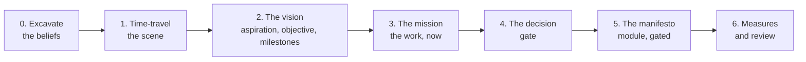

#  vision-and-manifesto (open skill)

**How to write a vision a company can actually run on — pictured first, proved by the decisions it changes.** Excavate the beliefs from decisions the company has already paid for. Stand in the future scene before writing a word of statement. Compress it on the pattern the research supports: one aspiration, a quantifiable objective, milestones, values at four or fewer. Write the mission as the same beliefs at today's work. Then pass both through a decision gate — three named decisions across hiring, firing, and money, and a clarity test on real roles — or send them back. A manifesto is written only when a named public job needs one.

##  What this is

An open skill that an AI agent can run, for the writing most companies treat as decoration and the research treats as machinery.

Vision work usually fails in one of two directions. The poster version starts from adjectives: a sentence assembled from value words — excellence, integrity, innovation — that no one can picture, no one can act on, and no one can be against. The meta-analyses of mission statements find the predictable result: the document alone does nothing. The guru version starts from a charismatic frame whose evidence is selected success stories, and borrows confidence it never earned. This skill takes the disciplined middle. The beliefs are excavated from costly decisions, not brainstormed. The language is image-based, because the measured research says images are what followers can simulate and act on, and fewer than one in ten leaders write that way by default. And the run is not finished when the sentences are good — it is finished when the sentences pass a gate: named decisions they change, and people in real roles who can say what the vision means for their work this quarter.

One core, three lengths. The vision is the future as a scene, compressed. The mission is the same beliefs pointed at the present. The manifesto is the public long form, and it is the exception: it exists only when a named public job — recruiting self-selection, movement-building, belief-as-product — needs it, because public belief language without a job spends credibility to no end. The three are compressions of one belief set, checked against the core, so they cannot drift into the two-text company: one vision for the deck, another for the building.

It answers three questions:

1. What does this company actually believe — proved by what it has already paid for — and what future scene do those beliefs point at?
2. Can the future be stated as one aspiration, a countable objective, and checkable milestones, in words a stranger can picture?
3. What decisions do the statements change — in hiring, in firing, in money — and can the people doing the work say what the vision means for theirs?

The skill runs standalone at a founding, a refounding, or the moment a team outgrows the founder's voice. Its record chains outward: positioning can excavate from a finished vision, comms borrows the core for public moments, and fundraising borrows it whole — a grander variant written for a raise is a claims violation under this skill's rules, not a communications choice.

##  Who it is for

| Reader | What they get |
| --- | --- |
| Founders and leadership teams | Beliefs written once, at a standard that survives contact with hiring, firing, and budget decisions — instead of re-negotiated in every room |
| Chiefs of staff and operators | A record with the gate results and a decision log: the machinery that keeps the statements honest after the offsite ends |
| Teams with wall-text statements | A diagnosis of why the current words change nothing, and a rebuild that starts from the company's own costly decisions |
| Agents running strategy work for a human approver | An output contract: one core at three lengths, the scene attached, the gate results named decision by decision, and the skipped modules stated with their reasons |

##  Process at a glance

##  How to use with an agent

| Step | What to give the agent |
| --- | --- |
| Name the occasion | The founding, pivot, or drift problem this run serves, and what an honest set of statements would unblock |
| Hand over the costly decisions | The customers refused, hires not made, money not taken, standards defended at a price — the excavation works from these, not from a values brainstorm |
| Expect the scene before the statement | A run that opens with adjectives is restarted at the scene; sit with the future in prose before judging any sentence |
| Sit for the gate | The decisions discussion is the work: three real decisions, old defaults named, enforcement owned. Nothing ships with those fields empty |
| Name the manifesto's job, or skip it | Recruiting self-selection, movement-building, or belief-as-product — in writing, in the record. No named job, no manifesto |
| Take the record, not the poster | The return carries the core, the scene, both statements, the gate results, the manifesto or the stated skip, and the review machinery |

##  Folder map

| Path | What it holds |
| --- | --- |
| `SKILL.md` | The one idea, the evidence in brief, the seven-step procedure, guardrails, the output contract, limits, and the verification checklist |
| `references/README.md` | Index of the depth material |
| `references/the-evidence.md` | The research base in full: each source, its findings, its grade, and its limits — including the sources weighed and left out, with the reasons |
| `references/the-decision-gate.md` | The gate in full: the decision test across hiring, firing, and money; the clarity mapping test; cost and enforcement; the failure modes; the decision log |
| `references/manifesto-module.md` | The gated module: the three named public jobs, the entry test, the manifesto's structure, and what a manifesto must never do |
| `references/worked-example.md` | A public worked example: SpaceX's "make life multiplanetary" read through the method — the pattern, the gate, and the standing costs of specificity |

##  Sources and credits

The method stands on the vision-communication research of Andrew Carton and co-authors: Carton, Murphy and Clark (2014) and Carton and Lucas (2018) in the *Academy of Management Journal* — image-based language over value words, the "blurry vision bias," the four-value limit — and Carton's NASA archive study (2018) for the structure of aspiration, quantifiable objective, and milestones. Content and communication come from Baum, Locke and Kirkpatrick (1998), who tied vision attributes to venture growth through communication. The gate stands on Bart, Bontis and Taggar (2001) — statements act only through changed behavior — and Gartenberg, Prat and Serafeim (2019), who found purpose related to performance only when paired with clarity. Collins and Porras (*Built to Last*, 1994) contribute vocabulary, labeled retrospective case lore under Rosenzweig's *Halo Effect* critique (2007). The mission-statement meta-analyses (Desmidt et al. 2011; Alegre et al. 2018) supply the caution the whole design answers: the document alone does nothing. Simon Sinek's Golden Circle is excluded by name in the skill's limits — no peer-reviewed test, discredited brain biology, selected success stories. No source text is reproduced.

##  Contributing

Improvements are welcome. The bar is the same as the method: a proposed change names its evidence — a run where a step failed in the field, research that contradicts a claim, a gate that passed statements which then changed nothing — and scored runs (a record, its gate results, and its decision log a year later) are the most valuable contribution there is.

##  License

MIT. See the repository LICENSE file.

##  Version

0.1.1 — field-test records now open plain, with plain verdict sections (see `CHANGELOG.md`). First build (0.1.0): one core at three lengths, the scene-first procedure, the decision gate, the gated manifesto module, and the vision record as the output contract. See `CHANGELOG.md`.
