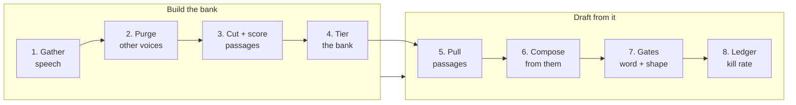

#  write-in-your-voice (open skill)

**A procedure for drafting in a person's real voice, built from how they actually speak.** This skill assembles the evidence base first — a source bank cut from the person's recordings and transcripts — then drafts from their own sentences under a gate that checks shape, not just words.

##  What this is

An **open, agent-oriented skill** for anyone whose AI drafts keep coming back with "this isn't my voice."

The obvious approach is to feed the model the person's published posts plus a style description. It fails in a specific way: if any of those posts were ghostwritten or AI-generated, the model learns its own voice back to itself, and the style description, however detailed, stays a catalogue the drafter edits toward instead of a source it writes from. This skill starts somewhere else and asks:

1. Where does this person actually talk on the record, and can we get the transcripts?
2. Which passages show them doing the moves — judging, explaining, warning — rather than doing housekeeping?
3. What did they say, in their own sentences, on the move this draft has to make?
4. If they never said it, why are we composing it instead of asking them to dictate it?

Three disciplines make this version different:

1.  **Speech first, posts last** — the source bank is tiered in writing: spoken passages, dictated explanations, approved texts, and published posts quarantined as contaminated unless the person vouches for a specific one.
2.  **Compose from their sentences** — structure is applied to what the person said; it never generates replacements for it. No source on the move means the deliverable is a dictation prompt, not a draft.
3.  **Gate the shape, not just the words** — in the case study inside, the rejected draft scored cleaner on the vocabulary checker than the approved one (2 flags vs 3). The failures live in openings, parallelism, and person, so that is what the shape gate checks.

##  Who it is for

| Audience | Use |
| --- | --- |
| **Founders / creators / executives** | Get drafts that sound like you because they are built out of your sentences; spend thirty seconds dictating instead of ten minutes rejecting |
| **Chiefs of staff / content operators** | Build and maintain the bank, run the drafting procedure, and keep the kill-rate ledger that proves whether it is working |
| **AI agents** | Load `SKILL.md`, build or use the bank, return drafts with their source passages and gate results — never an unsourced composition presented as the person's voice |
| **Maintainers** | Refresh `references/` when the method changes, bump `version` in `SKILL.md`, and record the change in `CHANGELOG.md` |

##  Process at a glance

##  How to use with an agent

1. **Load** [`SKILL.md`](./SKILL.md) as the skill.
2. **Name the run** — build the bank, draft a piece, or review a draft. Each run has a defined output in the skill.
3. **Pull references by branch:**

| Need | Read |
| --- | --- |
| Build the bank, step by step |  [`references/source-bank-process.md`](./references/source-bank-process.md) |
| See a real build, with its failure |  [`references/worked-example-the-bank-build.md`](./references/worked-example-the-bank-build.md) |
| Composed vs dictated, graded |  [`references/case-study-launch-pair.md`](./references/case-study-launch-pair.md) |
| Drafting and the gates in detail |  [`references/drafting-and-gates.md`](./references/drafting-and-gates.md) |

4. **Hold the guardrails.** The bank stays private, other speakers are purged and never quoted as the person, and nothing ships without the person's approval of the exact final text.

##  Folder map

| Path | One line |
| --- | --- |
| [`SKILL.md`](./SKILL.md) | Main skill: the principle, run outputs, bank procedure, drafting procedure, gates, guardrails, limits |
| [`CHANGELOG.md`](./CHANGELOG.md) | Version history |
| [`references/README.md`](./references/README.md) | Index of the reference files |
| [`references/source-bank-process.md`](./references/source-bank-process.md) | The six build steps in full, including passage scoring and the tier rules |
| [`references/worked-example-the-bank-build.md`](./references/worked-example-the-bank-build.md) | The production build the method was learned from, including the contamination failure |
| [`references/case-study-launch-pair.md`](./references/case-study-launch-pair.md) | One launch written two ways, with the word-gate scores that motivate the shape gate |
| [`references/drafting-and-gates.md`](./references/drafting-and-gates.md) | Procedure B in detail: sourcing, composing, the dictation prompt, both gates, the priority rule |
| [`assets/icons/`](./assets/icons/) | Hugeicons Free SVG icons used in the documents |

##  Sources and credits

- This skill is a method, not a summary of a book. It was built in production on the author's own content operation in November 2026, after two launch drafts in three days were rejected on voice while passing every word-level check.
- Its evidence is the build record, stored in `references/`: the bank statistics (1,149 transcripts, about 224,000 spoken words, 690 passages), the rejected and approved drafts graded side by side, and the kill-rate ledger the method is judged by.
- The dictation-prompt pattern and the hook-first structure (AIDA) are long-standing public practice in direct response and sales writing, credited here as structure, used on the person's own sentences.
- Content is **paraphrased**. No copyrighted text is stored in this folder.

##  Contributing

- Open a PR with a better bank-building step, a new purge or scoring pattern, or a graded draft pair with the person's verdict recorded.
- Keep the folder grep-clean: no private transcripts, no real person's bank contents, no live-matter details inside the skill.
- When the method changes, update the references, bump `version` in `SKILL.md`, and add a `CHANGELOG.md` entry.

##  License

MIT — see [`SKILL.md`](./SKILL.md) front matter. Third-party sources remain under their publishers' terms.

##  Version

Current skill version: see `version` in [`SKILL.md`](./SKILL.md) front matter. History: [`CHANGELOG.md`](./CHANGELOG.md).
