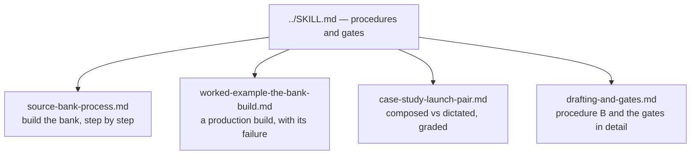

# References index — Write in Your Voice

These references support **Write in Your Voice**, version **1.1.0**. The main `../SKILL.md` holds the two procedures and the gates. These files carry the depth: the bank build in full, the production build it was learned from, the draft pair that proves why the gates are shaped the way they are, and the drafting detail.

Read the main skill first. Open a reference when the work needs depth. Do not load every file by default.

- `source-bank-process.md` — the six build steps in full: gathering, purging other voices, passage cutting and scoring, tiering, wiring, maintenance and the kill-rate ledger.
- `worked-example-the-bank-build.md` — the author's own production build: the numbers, the tiers, and the contamination failure that forced the rebuild.
- `case-study-launch-pair.md` — one launch written two ways: model-composed (rejected) and assembled from the person's dictation (approved), with the word-gate scores that show why words are the wrong layer to check.
- `drafting-and-gates.md` — Procedure B in detail: sourcing, composing, the dictation prompt, the word gate build, the three shape checks, and the priority rule.
