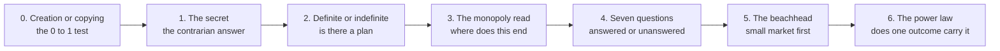

#  zero-to-one (open skill)

**How to test whether a venture creates something new — or only copies what exists.** Start with the verdict: 0 to 1, or 1 to n in disguise. Name the secret the venture rests on, in one sentence, with the observation that would prove it false. Read the plan for definite thinking and strike the parts that are only bets. Ask where it ends — monopoly or competition — and read the market for imitation, because copied desire is what competes profit away. Then work the seven questions, and finish with the beachhead: the small market to dominate first.

##  What this is

An open skill that an AI agent can run, for the question every pitch answers confidently and few plans survive: is this actually new?

Venture plans fail this question in two directions. The inflation version calls every improvement a creation, borrows the crowd's presence as proof of opportunity, and describes a future in the language of optionality — every door open, none walked through. The deflation version never asks the question at all, and discovers at the end of a well-executed decade that it built one of many, in a market that set its margins. This skill takes the disciplined middle, on Peter Thiel's frame. The verdict comes first and is read off the venture's own facts. The secret is stated in one sentence and tested three ways. The plan is rewritten as one definite claim with a date, and whatever cannot survive the rewrite is named a bet. The end state is scored for durability, and the market is read through René Girard's account of imitated desire — the mechanism that explains why smart people crowd into the same opportunity and compete its returns away.

The skill is honest about its instruments. The frame is a practitioner-philosopher's argument built on an extraordinary record, with survivorship bias as a property, not a risk; the mimetic lens is contested philosophy used for one narrow noticing job; the power law's shape has industry data behind it and no precise split worth quoting. So the frame supplies the questions, and every answer must come from the venture in front of the run — a verdict that leans on the frame's winners instead of the venture's facts fails the output contract.

It answers three questions:

1. Is this a creation or a copy — and what are the two or three facts that decide it?
2. What is the secret, is the plan definite, and does the venture end in a monopoly or in competition?
3. What is the small market it can dominate first — and in what order do the markets after it fall?

The skill runs standalone at a founding, a pivot, or before a raise or an investment. Its record chains outward: a creation verdict hands off to the business-model-canvas to record the model and to positioning to name what the new thing will be thought of as, and fundraising borrows the finished record whole — secret and unanswered questions visible, or not at all.

##  Who it is for

| Reader | What they get |
| --- | --- |
| Founders before a launch, pivot, or raise | The creation question answered on their own facts, with the secret stated and the indefinite parts of the plan named before the market names them |
| Investors and allocators | A record that separates the venture's evidence from its adjectives: seven questions answered or marked unanswered, durability scored, the crowd read for imitation |
| Operators handed a crowded market | A mimetic read that says whether the crowd is demand or imitation — and where desire is not looking yet |
| Agents running strategy work for a human approver | An output contract: the verdict first, the secret with its disprover, the definite claim, the monopoly read, the beachhead sequence, and the re-run triggers |

##  Process at a glance

##  How to use with an agent

| Step | What to give the agent |
| --- | --- |
| Name the occasion | The founding, pivot, raise, or investment this run serves, and what a defensible verdict would unblock |
| Hand over the evidence | The plan as written, the numbers that exist, the market's entry and margin facts — the rawer the better; what cannot be evidenced will be marked unanswered, which is information too |
| Expect the verdict to push back | If the venture is a copy, the run will say so and route the work to the execution skills; a request for a creation verdict anyway is recorded as the user's call, against the test |
| Sit for the secret | The one-sentence answer and its disprover are the work: what do you know that others do not, and what would prove you wrong. Nothing ships with those fields empty |
| Take the record, not the pitch | The return carries the verdict, the secret, the definite claim and its bets, the monopoly and mimetic reads, the seven answers, the beachhead sequence, and the triggers |

##  Folder map

| Path | What it holds |
| --- | --- |
| `SKILL.md` | The one idea, the evidence in brief, the seven-step procedure, guardrails, the output contract, limits, and the verification checklist |
| `references/README.md` | Index of the depth material |
| `references/the-evidence.md` | The sources in full: the frame and the lens, each graded, the power law's data, and the criticisms stated at full strength |
| `references/the-secret.md` | The secret worked slowly: the contrarian question, the two kinds of secret, the three tests, and the failure shapes |
| `references/the-seven-questions.md` | The seven questions in full, each with what a real answer looks like and the failure shape that gives a weak one away |
| `references/mimetic-desire.md` | The mimetic lens: the triangle of desire, convergence and rivalry, how to run the read from market facts, and what the read is not |
| `references/worked-example.md` | A public worked example: PayPal run through the whole procedure from the book's own account, survivorship warning standing |

##  Sources and credits

The frame is Peter Thiel's, written with Blake Masters (*Zero to One*, 2014, from Thiel's Stanford lectures) — practitioner and philosophical work, labeled as such, and never presented inside the skill as peer-reviewed evidence. The mimetic lens is René Girard's (*Things Hidden Since the Foundation of the World*, 1978), with Luke Burgis's *Wanting* (2021) as the accessible modern secondary; Girard's wider system is outside the skill's use. The power law's shape rests on industry analyses of venture returns (Horsley Bridge's fund data is the commonly cited one), graded as industry data: enough for the shape, never for a precise split. The criticisms — survivorship bias built into the frame's evidence, definite plans failing definitely, monopoly's abuses, a lens that can explain too much — are stated at full strength in the evidence reference and kept standing in the limits. No source text is reproduced.

##  Contributing

Improvements are welcome. The bar is the same as the method: a proposed change names its evidence — a run where the verdict called a copy a creation, a secret that passed the three tests and was false, a mimetic read the market's facts refuted — and scored runs (a record, its triggers, and what the triggers found) are the most valuable contribution there is.

##  License

MIT. See the repository LICENSE file.

##  Version

0.1.0 — first build: the creation verdict, the secret with its three tests, the definite-plan rewrite, the monopoly read with the mimetic lens, the seven questions, and the beachhead sequence as the output contract's center of weight. See `CHANGELOG.md`.
