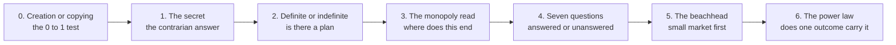

#  zero-to-one

> **How to read this**
>
> - **Agents:** Follow **Agent guardrails** and the **Core procedure** literally. The creation verdict comes first and is recorded. Every one of the seven questions is answered from evidence or marked unanswered. A run is not finished until the beachhead sequence is named.
>
> - **Humans:** Read **The one idea**, then the output contract. If a plan you are shown has no secret stated in one sentence, it is a consensus plan wearing a pitch — send it back.
>
> - **Index:** [`references/README.md`](references/README.md) · **Public overview:** [`README.md`](README.md)

**Not a substitute for the underlying work.** This skill tests whether a venture creates something new and can keep it. It does not decompose a problem to its bedrock facts (the first-principles-thinking skill's ground), record how a found model makes money (the business-model-canvas skill's ground), or decide the position the product owns (the positioning skill's ground). See **Limits and boundaries**.



## Sources

Full credit table: [`references/the-evidence.md`](references/the-evidence.md). The frame is Peter Thiel's, written with Blake Masters (*Zero to One*, 2014, from Thiel's Stanford lectures) — practitioner and philosophical work, labeled as such. The mimetic lens is René Girard's (*Things Hidden Since the Foundation of the World*, 1978): desire is imitated, and imitation is what crowds markets and inflates bubbles. The power law's shape in venture returns has industry data behind it; the rest of the frame is an argument, and the skill grades it as one.

## When to use

- **A founding or a pivot.** A venture is being started, or an existing company is betting on a new line, and someone must say plainly whether the bet creates something new or improves something that exists.

- **Before serious money.** A raise, an investment, or a year of a team's life is about to follow a plan. The run tests the plan's secret, its definiteness, and its end state before the money does.

- **A crowded market that feels like validation.** Everyone is building the same thing and the crowd is being read as proof of opportunity. The mimetic read in Step 3 tests that reading.

- **A plan full of options.** The strategy keeps every door open and commits to none. Step 2 names that for what it is: indefinite thinking, which this frame treats as the absence of a plan.

## When NOT to use

- **For scaling what already works.** Going from one to n — more cities, more segments, more of a proven thing — is execution, and it is honorable work. It does not need this test, and this test will only insult it. The business-model-canvas and the marketing plan serve it better.

- **As investment advice.** The run structures a judgment about a venture. It does not price a security, and its verdict is an argument with its evidence showing, not a recommendation.

- **To bless a plan retroactively.** A run commissioned to agree with a decision already taken will produce a record that says so, in the verdict, where the disagreement belongs.

- **On a person.** Girard's theory is used here as a lens on markets — where desire is being copied, and what the copying does to margins. Reading an individual's desires or motives is psychological profiling's ground, under its own evidence rules, not this skill's.

## Agent guardrails

1. **The verdict is creation or copying, stated first, on evidence.** New in kind — a capability, a market, a behavior that did not exist — or new only in degree. The two or three facts that decided it are recorded with it.

2. **No secret, no edge.** Every durable venture rests on a truth its builder knows that most others do not, or do not act on. If the plan's core claim is one everyone already agrees with, the record calls it a consensus plan, however well executed it may be.

3. **Definite beats indefinite.** A plan names a specific future and engineers toward it, with dates. Language that keeps options open — exploring, staying flexible, letting the market decide — is flagged wherever it substitutes for a plan, and the part that cannot be made definite is recorded as a bet, not a plan.

4. **Competition is a warning sign, not validation.** A crowded field is evidence that desire is being imitated, and imitated desire competes profit away. The run treats rivals entering as a cost to be explained, never as proof the opportunity is real.

5. **Small market dominated beats large market shared.** The sequence starts where the venture can take the whole of a small market, then expands to adjacent markets in a named order. A plan that opens with a small share of a huge market is recorded as the classic failure shape.

6. **An order of magnitude, or it is an improvement.** The creation claim needs a decisive advantage — roughly ten times better on the dimension that matters — not a marginal one. Marginal advantages are competed away; the record says which kind this is.

7. **Durability is asked now.** If the advantage cannot plausibly survive ten to twenty years — of imitation, of platform shifts, of the founders leaving — the record says why the venture is still worth doing, or the run stops.

8. **One record, shown whole.** The record shown to investors, partners, or a team is the operating record: the secret, the unanswered questions, and the bets all visible. A cleaned variant for an audience is a claims violation, the same rule this family of skills applies to canvases and positions.

## The one idea

Every moment in business happens once. The next Bill Gates will not build an operating system; the next Larry Page will not build a search engine. Copying what worked — going from one to n — adds more of what already exists, and the world it produces is familiar. Creating — going from zero to one — does something nobody has done before, and the profits follow the novelty: a creation can become a monopoly, earning durable returns, while copies compete until the profit is gone. So the first question about any venture is not how big the market is or how strong the team looks. It is whether the thing is new, what secret it rests on, and whether its advantage can last. Thiel's frame adds two disciplines most plans skip. The plan must be definite: a specific future, chosen and engineered, not a portfolio of options held against uncertainty. And the market must be read for imitation: people copy each other's desires, so the crowded opportunity everyone wants is usually the one where the wanting itself destroys the return. This skill runs those questions in order and writes down the answers, with the unanswered ones marked.

## The evidence in brief

Every load-bearing claim is labeled here; the full table, with grades and limits, is in [`references/the-evidence.md`](references/the-evidence.md).

- **The frame is an argument by a practitioner-philosopher, and is labeled so.** *Zero to One* (Thiel with Masters, 2014) generalizes from Thiel's own record — PayPal, Palantir, early Facebook money — and from a philosophy of history: definite optimism builds, indefinite optimism waits. It is not peer-reviewed evidence, and the skill never presents it as any. Its questions are used the way good questions are used: for the discipline of answering them with evidence.

- **The power law has data behind its shape.** Venture returns are heavily concentrated: industry analyses (Horsley Bridge's fund data is the commonly cited one) find a small share of investments returning the majority of the whole. The exact figures vary by dataset and era and are graded as industry data in the evidence reference — enough to take the shape seriously, not enough to quote a precise split as fact.

- **Mimetic theory is a lens, not a measurement.** Girard's claim — desire is triangular, copied from a model — is philosophical anthropology, contested in its home fields and not falsifiable the way a market claim is. This skill uses it for one narrow job: explaining why smart people crowd into the same opportunity and compete its returns away, a pattern any operator can check against the market in front of them. The lens earns its place by what it notices, and the limits section keeps its status plain.

- **The criticism is named, and carried in the open.** The frame generalizes from winners, so survivorship bias is built into its evidence; indefinite strategies sometimes win, and some monopolies are built by acquisition and regulation rather than by secrets. The limits section states these at full strength. The skill's response is structural: every claim in a run is tied to the venture's own evidence, so the frame supplies the questions and never the answers.

## Core procedure

### Step 0 — Creation or copying: the 0 to 1 test

Decide, on evidence, what kind of venture this is. **Creation:** the offer does something that could not be done before, or serves people who were not served, in a way that changes what they can do. **Copying:** the offer improves an existing thing on dimensions buyers already compare — faster, cheaper, nicer — inside a market that already exists. Most ventures are honest mixtures; the verdict names the dominant kind and the facts that decided it. A copying verdict is not a death sentence — it routes the work to the skills that serve execution — but it ends this run's central question, and the record says so plainly. **Sibling call — first-principles-thinking:** before the verdict is taken from the venture's own description of itself, decompose "new" to bedrock: what can now be done, by whom, that was impossible or impractical before — and what made it possible. Novelty claimed at the level of adjectives is re-tested at the level of facts.

### Step 1 — The secret

Answer the contrarian question in one sentence: **what important truth do very few people agree with you on?** Then classify the secret it points to. A **secret about nature**: a fact about the world — a cost curve, a behavior, a technical possibility — that is true and not yet widely known. A **secret about people**: something most people do not see, or cannot say, about what people actually want or will actually do. Then test it three ways. If everyone came to believe it tomorrow, would the advantage survive — or is the edge the not-knowing itself? What evidence, beyond the founder's conviction, says it is true? And what observation would prove it false? A claim that cannot state its disprover is a belief, and is recorded as one. The full method is in [`references/the-secret.md`](references/the-secret.md).

### Step 2 — Definite or indefinite

Read the plan as a document about the future. **Definite:** it names a specific state of the world — this product, for these people, at this scale, by this date — and the steps are engineered backward from it. **Indefinite:** it hedges — optionality praised as strategy, milestones that are really observations, a future described as something that will happen to the venture rather than something the venture will make happen. Rewrite the plan's core as one definite claim with a date. Whatever cannot survive the rewrite is recorded in the record's bets line: named, owned, and no longer dressed as a plan.

### Step 3 — The monopoly read

Ask where this ends. **Monopoly:** the venture becomes the only real answer for a defined group of people, with pricing power and an advantage that compounds. **Competition:** the venture becomes one of many, and the market sets its margins. Score the four sources of durability Thiel names — **proprietary technology** (the order-of-magnitude advantage from Step 0), **network effects** (each user making the offer better for the next), **economies of scale** (costs falling as it grows), and **branding** (trust that cannot be bought quickly) — each present, building, or absent, on evidence. Then run the **mimetic read**: whose desire is being copied in this market — by the venture, and by its rivals? Where a crowd wants the same object because the others want it, rivalry is the future and margins are the casualty. The method is in [`references/mimetic-desire.md`](references/mimetic-desire.md). **Sibling call — game-theory-for-decisions:** the rivals and imitators are mapped as players — what each wants, what each will do if this venture wins its first market, and which of their moves the beachhead sequence must answer.

### Step 4 — The seven questions

Work Thiel's seven questions in order. Each is answered from evidence or marked **unanswered** — an unanswered question is a finding, not a gap to be smoothed over.

1. **Engineering** — can this create a breakthrough, roughly ten times better, rather than an improvement?

2. **Timing** — why is now the right moment: what changed that makes the secret actionable today and not five years ago or five years hence?

3. **Monopoly** — does the plan start with a large share of a small market (Step 3 and Step 5 carry this)?

4. **People** — can the team actually build and sell this: the specific people, on the specific work, with the gaps named?

5. **Distribution** — is there a real way to deliver the offer to its people, beyond the hope that a good product spreads itself?

6. **Durability** — will the position still stand in ten to twenty years (Step 3's sources, projected)?

7. **Secret** — has the run found a chance others have not seen (Step 1 carries this)?

The questions in full, with what a real answer looks like for each, are in [`references/the-seven-questions.md`](references/the-seven-questions.md). **Sibling call — fundraising:** when the run feeds a raise, the seven answers and the secret are the deck's spine — a raise priced on a consensus claim with indefinite language is repriced by the market, and the record says so before the roadshow does.

### Step 5 — The beachhead sequence

Name the sequence. **First market:** small enough to dominate completely, specific enough that its people can be listed, and chosen because the secret bites hardest there — not because it is the largest reachable number. **Then:** the adjacent markets, in order, each with its expansion logic — same users, new offer; same offer, neighboring users; the network or the cost curve carrying outward. Each step states what the previous step's dominance buys. A sequence whose first step is "a small share of a very large market" fails this step outright, and the record says so.

### Step 6 — The power law, and the close

Close with the concentration question. Outcomes in new ventures follow a power law: a small number of results carry the whole. So: is this the venture — or, for an investor, the position — where the outsized outcome plausibly lives, and is the commitment sized as if that were true? A definite plan on a power-law venture justifies full commitment; a hedged commitment to a consensus plan is the worst cell in the table, and the record names it if that is what it sees. End the record with the **change triggers**: the events that would force a re-run — the secret becoming consensus, a rival taking the beachhead, the timing fact reversing — and a review date.

## Calls on sibling skills

This skill does not run alone; the playbook is one playbook, and a skill calls the siblings its work needs, by name, at the step that needs them. The calls are steps, not suggestions:

- **Step 0 calls first-principles-thinking** — the creation verdict is read off a decomposition of the claimed novelty to bedrock facts, so "new" is never taken from the venture's own adjectives.

- **Step 3 calls game-theory-for-decisions** — rivals and imitators are mapped as players with payoffs and likely moves; the monopoly read records the game that call returns, including where mimetic convergence makes rivalry certain.

- **Step 4 calls fundraising** — when the run feeds a raise, the secret and the seven answers become the raise's spine, and indefinite language in the plan is treated as a pricing problem, not a style problem.

- **After a creation verdict, the run hands off** — to business-model-canvas, to record the model the creation will run on, and to positioning, to name what the new thing will be thought of as. This skill decides whether the venture is a creation worth a monopoly; those skills record how it operates and how it is seen.

## Output contract — the zero-to-one record

Every run returns one record. The verdict leads, because a reader should know whether they are looking at a creation or a copy before they read a single answer.

```text
— The verdict —
Creation verdict:     <0 to 1 / 1 to n in disguise / not yet either — and the two or three facts that decided it>
Record date:          <the date this snapshot was taken>

— The secret —
The secret:           <one sentence — the important truth few agree with>
Kind:                 <about nature / about people>
Evidence:             <what says it is true, beyond conviction>
Disprover:            <the observation that would prove it false — or "none statable: recorded as a belief">

— The plan —
Definite claim:       <the specific future, with its date>
Bets, not plans:      <the parts that could not be made definite, named as bets>

— The monopoly read —
End state:            <monopoly / competition — and why>
Durability sources:   <proprietary technology / network effects / scale / branding — each present, building, or absent, with its evidence>
Mimetic read:         <whose desire is being copied in this market, and what the copying does to the returns>

— Seven questions —
1. Engineering:       <answer + evidence — or UNANSWERED>
2. Timing:            <…>
3. Monopoly:          <…>
4. People:            <…>
5. Distribution:      <…>
6. Durability:        <…>
7. Secret:            <…>

— The beachhead sequence —
First market:         <the small market to dominate completely, and why the secret bites hardest there>
Then:                 <adjacent markets in order, each with its expansion logic>

— The power law —
Concentration read:   <whether the outsized outcome plausibly lives here, and whether the commitment is sized as if it did>

— Change triggers —
Re-run if:            <the named events that force a re-run>
Review date:          <when this record is next re-examined, trigger or not>
```

**Then run the writing pass. This step is a procedure, not a style reminder.** When a record ships in workshop register, the answers fill with template language — "disruptive innovation," "massive TAM" — and the record loses the plain statement of what is actually claimed that makes it usable.

1. **Humanizer.** Run the work-humanizer skill in rewrite mode over the record. Facts, figures, labels, and statuses never change in the pass. What changes is the register.

2. **Plain style.** Apply the writing-styles skill's plain rules to the result: short sentences, one idea each, numbers spoken the way a person says them, bold only on the few facts that matter. The secret is written the way its holder would say it out loud, not the way a pitch template would.

3. **The gate.** The record is not done until the pass has run on the exact text being delivered.

**Field-test records carry one more requirement.** When a run is filed as a field test of this skill, the record opens with a plain section — the verdict and the headline findings in short sentences a person would say out loud — before any working detail. The verdict sections themselves, the creation verdict and the verdict on the skill, are written plain in their own right: dense analyst prose with a plain summary pasted on top fails this contract. The plain-style rule applies by name to the human-read parts of a field-test record — the opening and every verdict. Working detail below the opening may stay as dense as the evidence needs.

## Limits and boundaries

- **The frame generalizes from winners, and says so.** Thiel's evidence is his own extraordinary record and the companies around it. Survivorship bias is not a risk in this material; it is a property of it. Plans that followed these rules and failed are not in the book. The skill's answer is structural, and it is only partial: the frame supplies the questions, and every answer must come from the venture in front of the run — a verdict that leans on "Thiel's winners did this" instead of the venture's own facts fails the output contract.

- **Indefinite sometimes wins.** Definite optimism is a stance, not a law. Options, hedges, and fast following have built real companies, and some markets punish the definite planner whose one future does not arrive. The skill records indefinite language because the frame demands it; a user whose situation genuinely rewards optionality should be told the frame is against them and why, not be argued into a plan the evidence does not support.

- **Monopoly is a lens on durability, not a legal or moral position.** The frame uses monopoly to mean a durable, defensible position that earns its returns by being the only real answer. It is not advice about antitrust law, market power over people who cannot leave, or conduct toward competitors — and a run never recommends acquiring, excluding, or deceiving anyone. Where a venture's durability would rest on lock-in of people who cannot exit, the record names that as the source, plainly, and lets the user judge it.

- **Mimetic theory is contested in its home fields.** Girard's account of desire is philosophical anthropology. Anthropologists and psychologists dispute its scope, and it is not falsifiable the way the venture's market claims are. This skill uses it for one job — noticing imitation and its effect on returns — and grades it accordingly in the evidence reference. A run that treats a mimetic reading as a measured fact has misused the lens.

- **Not first-principles-thinking.** That skill decomposes a problem to bedrock facts and rebuilds. This skill borrows one decomposition at Step 0 and spends the rest of its run on questions first principles does not ask: the secret, the definiteness of the plan, the end state, the sequence. A problem that needs rebuilding from facts needs the other skill first.

- **Not business-model-canvas.** The canvas records how a business makes money, searching or found. This skill runs earlier and narrower: whether the business is a creation at all, and whether its advantage can last. A creation verdict hands off to the canvas; a canvas, however well filled, never substitutes for the verdict.

- **Not positioning.** Positioning decides what a product will be thought of as. The secret and the beachhead constrain that decision — the first market is where the position must be ownable — but this run does not write the position.

- **Not a fundraising variant.** The record shown in a raise is this record, unanswered questions visible (Guardrail 8). A version with the secret inflated or the bets deleted is a claims violation. Fundraising borrows the finished record the way it borrows a finished canvas: whole, or not at all.

## Verification checklist

Before calling a run done, confirm:

- [ ] The creation verdict ran first and leads the record, with the two or three facts that decided it.

- [ ] The secret is stated in one sentence, classified (nature or people), carries its evidence, and states its disprover — or is recorded as a belief.

- [ ] The plan's core is rewritten as one definite claim with a date, and everything that could not be made definite is named in the bets line.

- [ ] The monopoly read scores all four durability sources on evidence, and the mimetic read names whose desire is being copied and what the copying does to returns.

- [ ] All seven questions are answered from evidence or marked unanswered; none is smoothed over.

- [ ] The beachhead sequence starts with a small market the venture can dominate completely, and each later market carries its expansion logic.

- [ ] The power-law read is recorded, including whether the commitment matches it.

- [ ] The record is dated, its re-run triggers are named, and a review date is set.

- [ ] Only one version of the record exists — the operating record, secrets and unanswered questions visible.

- [ ] The writing pass ran on the exact text delivered — humanizer, then plain style.

- [ ] If this run is filed as a field test: the record opens with a plain verdict section, and its verdict sections are written plain in their own right.
